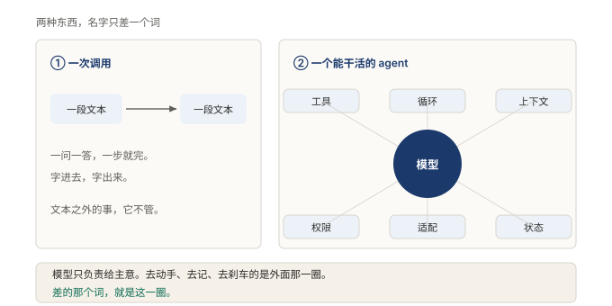

# §00 序章 最中间的那一层，可以整块抽走

先说一件反常识的事。

这本书讲的那套系统，最中间的那一层可以整块抽走。不是改几行、补几个接口的那种抽法，是整个拿掉，换一副新的放回去，外面所有部分一行都不用改，系统照常开工。

干过软件的人都知道这件事有多反常。随便哪套系统，最中间总是最难动的地方。订单主流程、登录模块、那段谁也不敢碰的历史代码，改一次，别的模块跟着抖三抖。中心就该是焊死的，这是常识。

这套系统把常识倒了过来。倒过来的理由、做法、代价，是这本书要讲的事。

## 这本书在讲什么

大模型的本事大家都见过了。写代码、读文档、讲道理，问一句答一句，答得像模像样。

可让它真去干活，事情就不对了。读一个文件，跑一条命令，改错了改回来，干到一半断了明天接着干。这些活，模型自己一件都够不着。它会想，不会动手。

**图 1：模型还是同一个模型，能不能干活全看外面那一圈**〔本书〕

左边是大多数人熟悉的用法：话进去，话出来，中间什么都没有。右边才能把活干成：模型还在正中间，外面围上了一整圈人马，管动手的、管记事的、管把关的、管定下一步的。同一个模型，接上这一圈就能干活，不接就只会聊天。

这一圈就是这本书的对象。它有个名字，叫 harness，书里叫它外壳。模型几个月换一代，快得来不及追；这一圈里沉淀的东西，却几年都不用动。谁把这一圈想清楚，谁就不用在每次模型换代时从头再来。

## 全书地图

这本书分六部，按从外到里的顺序走。

第 1 部进门，说清楚这件事是什么、难在哪，为什么值得专门写一本书。第 2 部先看一眼，把整栋楼拆开，六层各管什么，先给地图不给理由。第 3 部拆内核，五个房间逐个进，每进一个讲清一条设计主张。第 4 部走一遍，跟着一句问话、一次工具调用，看这些东西怎么转起来。第 5 部碰边界，讲它在哪里会塌，出过什么事，代价是什么。第 6 部收，把能带走的判断留下，别的放下。

## 怎么读这本书

每一节都分两层。第一层讲人话，用师傅带队伍干活的故事把设计讲完，一个术语都不出现。第二层上术语，正式名字、机制、边界、代价，给要去自己动手的人。

只想知道个大概，读第一层就够。要拿去用，两层都读，再翻翻节末的对照表和易错点。

书里的类比全书通用：师傅的脑子是模型，一整套人马是外壳。第 1 部会把它从头讲一遍，后面各节直接用，不再解释。

那么，回到开头那件反常识的事。最中间那层凭什么能整块抽走？答案在第 3 部。但先得进门，看看这一圈到底在管什么。

<!-- FIGURES
图 1 fig-0-1-one-call-vs-agent 〔本书〕
-->
