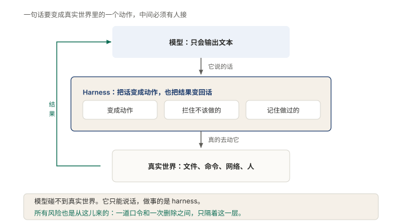

# §01 模型明明会写代码，为什么还是干不成活

现在的模型，代码写得比很多熟手都快。给它一段报错，它能说出病因；给它一个需求，它能写出像模像样的实现。

可把这个模型接进日常开发，让它真去干活，事情立刻不对劲。它说「我先看一下配置文件」，然后就没有然后了。它说「我把测试跑一遍」，终端里什么都没有发生。它说得头头是道，手上空无一物。

这不是模型不够好。这一节要讲的是：差的从来不是那颗脑子，是脑子外面那一圈。照例分两层，先讲人话，再上术语。

## 1.1 小白版：师傅站在门口，进不了厨房

家里厨房的灯不亮了，叫个修灯师傅。师傅来了，站在门口，隔着门喊：「先断电，再拆开开关看看，可能是线松了。」

说得全对。可他自己没有手。够不着开关，拧不动螺丝，连电闸都拉不下来。喊得再对，灯也不会自己亮。

AI 就是这么个师傅。它的脑子极好，知道每一步该怎么走，但它自己一步也走不了。想让它把灯修好，得给它配一整套人马：拧螺丝的，照它说的动手；记笔记的，把干过的事记下来，免得干到一半忘了前面；把门的，它说要砸墙的时候拦一句「这面墙能不能砸」；领班的，看情况、决定、动手、看结果、再决定，把整件事的节奏串起来。

**图 1：师傅还是同一个师傅，配上人马才能干活**〔重印自 §00〕

左边是只有脑子的师傅：话进去，话出来，灯还是黑的。右边是配上人马的师傅：人马围着他转，他说一句，有人动一次手，有人记一笔账，有人把一道关。灯就是这样亮的。

注意一件事：左右两边是同一颗脑子。差别全在外面那套人马。所以「它会不会干活」这个问题，问脑子是问不出答案的，得看人马配得怎么样。

这套人马要干的活，数下来是六件。跟着师傅的吩咐一连走好几轮，不能走一轮就散伙；真去动手，读东西、改东西、把该跑的东西跑起来；哪些话该记着哪些话该丢，心里有数；危险的活先拦下来问一句；干过的事留底，明天来了能接着干；师傅要是换了人，队伍不用重招。

六件活，没有一件是师傅自己能办的。件件都得人马里有专人顶上。

## 1.2 专业版：外面那一圈要管的六件事

这套人马有正式名字，叫外壳（harness）。它是模型和真实世界之间的那一整层，模型出主意，它把主意变成行动。

**图 2：外壳上接模型、下接真实世界，模型的每句话都要经过它才能落地**〔本书〕

图上中间那个框就是外壳。模型在上面，只产出文字；真实世界在下面，只认动作。中间这层的职责，拆开来是六件事。

第一，agent 循环。维持多轮来回：观察现状、决定下一步、执行、读结果、再决定。模型只负责其中「决定」那一拍，其余各拍都是循环在走。

第二，工具执行。模型说「运行测试」，得有人真的去执行这条命令，并把输出带回来。读文件、写文件、跑命令，都归这件。

第三，上下文管理。模型的记性有上限，哪些历史该留下、哪些该丢掉、留下的怎么排，直接决定它下一步的判断质量。

第四，权限与沙箱。模型的提议不等于许可。要删掉整个目录的命令，得先被拦下来，按规矩问一句。

第五，会话状态。做过什么、做到哪一步，要落在模型之外的地方。任务中断后接着干，靠的不是模型的记性，是这份记录。

第六，模型适配。换一个模型，调用方式、返回格式、能力边界都不一样。这层差异该由外壳吸收，不该漏进业务逻辑。

六件事有一条共同的性质：模型一件都办不了，它们全都要由代码去接。这就是「外壳」存在的理由，不是锦上添花，是缺了它模型就只剩一张嘴。

适用边界也要说清。外壳不是越厚越好。外面那一圈每厚一分，读懂它的成本就高一分。厚度必须换来职责清晰：六件事各归其位，谁管什么一眼看得见。厚厚一圈却说不清楚哪件事归谁管，那是最坏的结果，比没有外壳还难维护。

## 1.3 两种说法的对照

本节新出现的说法，对应关系如下。全书通用的那套类比（师傅的脑子、一整套人马这些），到第 3 部会交一份完整对照表，这里只收本节的新词。

| 小白说法 | 专业术语 |
|---|---|
| 话进去，话出来 | 单次调用（single call） |
| 跟着吩咐一连走好几轮 | agent 循环（agent loop） |
| 干过的事留底，明天接着干 | 会话状态持久化（session persistence） |
| 师傅换了人，队伍不用重招 | 模型适配（model adapter） |

## 1.4 最容易理解错的地方

第一处：把干不成活归咎于模型不够聪明。错。同一个模型，接上外壳就能干活，不接就只会聊天。瓶颈在外面那一圈，不在脑子。

第二处：以为把六件事写进提示词就行了。错。提示词能告诉模型该怎么做，但读文件、拦危险命令、断点续干这些动作，提示词一件都执行不了。它们必须由代码完成，这是提示词和外壳的分界。

第三处：以为外壳是模型的附属品，模型升级外壳跟着换。恰好相反。模型几个月换一代，外壳里沉淀的东西几年都不用动。设计得好的外壳，换模型像换师傅，队伍还是那支队伍。

## 1.5 这条能搬去哪

一个自查动作。随便找一个号称能干活的 AI 产品，对着六件事逐项对：多轮来回谁维持，动手谁执行，记性谁管，危险动作谁拦，记录谁留，换模型怎么办。答不上来的那几项，就是它干不成活的地方。

反过来也成立。评估自己手里的项目，看这六件事散落在哪。如果它们混在业务逻辑里，每一处模型调用都各管各的，那就是还没有外壳，只有一堆散件。

<!-- FIGURES
图 1 fig-0-1-one-call-vs-agent 〔重印自 §00〕
图 2 fig-0-2-harness-in-between 〔本书〕
-->
