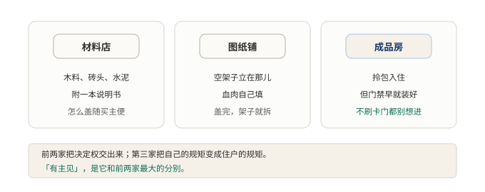

# §02 harness 到底是什么，和框架有什么不一样

上一节说，差的不是模型，是外面那一圈。那一圈有个名字，叫 harness。

这个名字值一节。因为圈子里用得很乱。有人管它叫框架。有人管它叫脚手架。还有人干脆叫它「那个命令行工具」。名字乱了，谈设计就谈不下去。这一节把词义钉死，顺便把最容易混淆的三个邻居分开。还是先讲人话，再上术语。

## 2.1 小白版：马具、材料店和成品房

harness 这个词，本来是马具。

套在马身上的一整套皮带和挽具。马只会跑，不会拉车。要让它变成能拉货的牲口，得把它的劲引到车上去。干这件事的就是马具。

马具有个很妙的地方：它不改马。马还是那匹马，脾气、脚力一点没变。它改的是马使出来的劲往哪儿去。软件里借这个词，借的就是这层意思。外面那一圈不改师傅的脑子。它安排的是脑子的力气怎么落到活上。

**图 2：人马不改师傅，只把师傅的力气引到活上**〔重印自 §01〕

师傅在上面出主意，活计在下面等结果。中间这套人马就是马具。主意从上面下来，动作往下面去，来回都得过它。

弄清了马具，再看它最容易被认错的三家店。要盖房，街上能买到三种东西。

第一家是材料店。木料、砖头、水泥，附一本说明书。它很客气：要什么拿什么，怎么盖随买主便，它绝不插手。第二家是图纸铺。地基打好了，墙的位置画好了。空架子立在那儿，血肉自己填，填完架子就拆。第三家是成品房。拎包入住，但房子有主见。门禁早就装好了，不刷卡门都别想进。装不装门禁这种事，它根本不问。

三家都自称帮人造房，脾气完全不同。材料店把决定权全交出来，出了事买主自己扛。图纸铺给个头，尾自己收。成品房把自己的规矩变成住户的规矩，住进去就得照它的来。外面那一圈是第三种：它不是一堆零件，是一套带着规矩的成品。把门的说不行，就是不行，没有商量。

**图 3：三家都自称帮人造房，脾气完全不同**〔本书〕

前两家把决定权交出来，第三家把自己的规矩变成住户的规矩。这个「有主见」，是它跟前两家最大的分别，也是后面所有故事的根。

## 2.2 专业版：行业公式、核心不变式与三条分界

行业里有条半开玩笑的公式：Agent = 模型 + 外壳。配套的调侃是：如果你不是模型，你就是外壳。玩笑归玩笑，这条公式把讨论对象钉住了。模型之外、为了让它干活而存在的一切，统称外壳。

外壳有一条核心不变式。模型提议，外壳授权、执行、记录、恢复。模型产出的是建议，不是事实；要不要放行、真的去做、做完了留底、断了能接回来。这四拍，全在外壳手里。不变式的意思是：无论哪家实现、换什么模型，这四拍的归属不许变。

再说三条分界。外壳和框架的分界，判据只有一条：谁的入口先跑。用框架，程序从自己的入口开始跑，在需要的位置调用框架；用外壳，程序从它的入口开始跑，自己写的东西挂进去等它调用。控制流方向相反。框架的扩展是调出来，外壳的扩展是挂进去。

外壳和脚手架的分界在寿命。脚手架服务于搭建期，房子盖完就拆。外壳是长期住户，只要系统还在干活，它就一直在场，每一次提议都要过它。

外壳和两者的共同分别是有主见。框架和脚手架都是谦让的，给材料、给图纸，不替人做决定。外壳是有主见的成品房。它不跟住户商量「要不要权限校验」。规矩直接立在那，不校验门都别想进。这份强制不是缺陷，是它敢把模型接到真实世界上的底气。

外壳里装着哪几样东西？就是上一节数过的六件。agent 循环、工具执行、上下文管理。权限与沙箱、会话状态、模型适配。六件凑齐，模型的提议才能走完授权、执行、记录、恢复这四拍。少一件，不变式就破一个角。

边界和代价也要摆出来。成品房的代价是迁就。它的规矩不一定合所有人的意，不认同就得绕开或者搬走。有主见换来的安全，是用让渡自由付的账。这笔账划不划算，要看接的是什么样的活。这也是下一节三家做法分歧的起点。

## 2.3 两种说法的对照

本节新出现的说法，对应关系如下。

| 小白说法 | 专业术语 |
|---|---|
| 材料店，自己盖房 | 框架（framework） |
| 图纸铺，空架子盖完就拆 | 脚手架（scaffolding） |
| 有主见的成品房 | 外壳（harness） |
| 不刷卡门都别想进 | 强制性约束（默认开启、不可绕过的校验） |
| 主意从上面下来，动作往下面去 | 模型提议，外壳授权、执行、记录、恢复 |

## 2.4 最容易理解错的地方

第一处：把 harness 当成框架的洋名字。错。两者的控制流方向相反，判据是程序从谁的入口先跑。名字像，脾气相反。

第二处：以为外壳是模型的配件，主角是模型，外壳随便搭搭就行。错。核心不变式里，授权、执行、记录、恢复四拍全在外壳手里。模型只占提议一拍。谁是主角，看拍数就知道。

第三处：以为有主见是缺点，是不灵活。错。不校验门都别想进，恰恰是外壳敢把模型接进真实环境的理由。谦让的框架把这份责任留给了使用方。有主见的外壳把它收进了自己手里。是分工不同，不是高下之分。

## 2.5 这条能搬去哪

一个自查动作。拿一个常用的库或平台，问一句：程序从谁的入口先跑？从自己的入口跑、需要时调它，那是框架；从它的入口跑、自己的代码挂进去，那是外壳。再补一句：它的规矩能不能绕过？能绕过的是材料，绕不过的才是成品房。两问下来，手里的东西姓什么就清楚了。

<!-- FIGURES
图 2 fig-0-2-harness-in-between 〔重印自 §01〕
图 3 fig-02-three-shops 〔本书〕
-->
