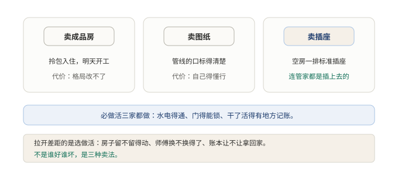

# §03 同样是外壳，为什么三家造出三种东西

外壳该管什么，前两节说清了。照理说，管同六件事，各家造出来的东西应该差不多。

实际上差得很远。市面上有三家有代表性的外壳，摆在一起看，像是三个行业的产品。这是全书唯一一节横向对比，看清这三家的分歧，才能看懂这本书的主角为什么长成那个样子。还是先讲人话，再上术语。

## 3.1 小白版：三家装修公司接同一个活

同一条街上三家装修公司，接的是同一个活：给师傅配一套人马，让他能把活干成。

第一家卖成品房。人马齐备，规矩定好，拎包入住。今天签约，明天师傅就能开工。代价是格局改不了：墙不能砸，家具就这些，想换一种带队伍的方式，只能等房东出新户型。

第二家卖图纸。房子长什么样它不包办，但水电煤从哪进、管线的口留在哪，图纸上标得清清楚楚。照这个口，接谁家的管子都行。它卖的不是房，是那个口。想要自由，自己得懂行。

第三家卖插座。房子里几乎是空的，只有一排排标准插座。冰箱、洗衣机自己带，插上就能用。最特别的是，连管家都是插上去的，看他不顺眼，拔下来换一个。空到了家，也自由到了家，但置办家当的活，全落在自己头上。

三家的必做活是一样的。水电得通，门得能锁，师傅干了活得有地方记账。这些活谁家都不敢省，也都做下来了。拉开差距的是选做活：房子留不留得动、师傅换不换得了、账本让不让拿回家自己看。成品房说不必，图纸说可以商量，插座说全都随你。

**图 4：必做活三家都做，拉开差距的是选做活**〔本书〕

所以这不是一场谁好谁坏的比赛，是三种卖法。看清卖法，比争出高下有用得多。

## 3.2 专业版：八维度对比与两种考题

三家各有名字。卖成品房的是 Claude Code，卖图纸接口的是 Codex CLI，卖插座的是这本书的主角 DSH。

先交代背景：三家的功能面已经收敛。记忆与指令文件、分层配置、外部能力接入、沙箱加审批、无界面运行、企业托管，这些三家都有。比的不再是功能有无，而是同一圈事上的取舍。真正的分歧在下面八个维度。

| 维度 | DSH | Claude Code | Codex CLI |
|---|---|---|---|
| 开源 | 开源（MIT） | 闭源 | 开源 |
| 架构 | 插件内核 | 垂直集成 | 垂直集成 |
| 哲学 | 一切皆插件 | 开箱即用 | Protocol-first |
| 模型 | 任意兼容端点 | 仅自家模型 | 仅自家模型 |
| 会话日志 | 本地明文，仅追加，可分叉可重放 | 托管 | 托管 |
| 运行时自扩展 | 支持热加载 | 不支持 | 不支持 |
| 默认沙箱 | 只读，故障安全 | 权限提示 | 权限提示 |
| 已收敛功能（记忆文件、分层配置、托管等） | 有 | 有 | 有 |

表里的分歧可以归成一行：Claude Code 卖成品，Codex CLI 卖接口，DSH 卖插座。成品房把决定都替人做好了；接口把接法规定好，剩下的自己接；插座连管家都是插上去的，房子里几乎不留固定岗位。

换个角度看，这八行是两份考卷。一份是必答题：循环、上下文、工具接入、会话持久、权限沙箱。这五道三家都答了，答案大同小异，这是行业的及格线。另一份是选答题：内核要不要空置、模型要不要插件化、日志要不要可重放。这三道，只有 DSH 这么选，另外两家选择了把答案收在自己手里。

选答题的关键在代价的走向。DSH 的答案不是更好，是把复杂度从实现方转移给了使用者。内核空置，意味着读一遍代码看不出系统在干什么，行为要从配置里重建；模型插件化，意味着接什么模型自己负责；日志可重放，意味着保管和利用日志是自己的事。成品房把这些麻烦吞下去，住户省心；插座把这些麻烦交出来，住户自由。谁付这笔账，是三家真正的分歧。

## 3.3 两种说法的对照

本节新出现的说法，对应关系如下。

| 小白说法 | 专业术语 |
|---|---|
| 卖成品房 | 垂直集成、开箱即用（Claude Code） |
| 卖图纸，管线的口标清楚 | Protocol-first，卖接口（Codex CLI） |
| 卖插座，管家也是插上去的 | 一切皆插件、内核空置（DSH） |
| 必做活 | 必答题：循环、上下文、工具接入、会话持久、权限沙箱 |
| 选做活 | 选答题：内核空置、模型插件化、日志可重放 |

## 3.4 最容易理解错的地方

第一处：把三家对比看成功能竞赛，数谁家功能多。错。功能面早已收敛，该有的三家都有。真正的分歧是复杂度由谁付，这在功能清单上看不出来。

第二处：以为选答题答得多就是更先进。错。选答题是取舍题，不是加分题。内核空置换来替换自由，付出的是可读性；开箱即用付出的是改造空间。两种付法对应两类用户，没有高下。

第三处：以为开源和插件化是一回事。错。开源说的是看不看得到、改不改得了源码；插件化说的是换一样能力动不动主体。三家在两条轴上的位置各不相同，不能混成一条。

## 3.5 这条能搬去哪

一个自查动作。评估任何一个 agent 产品，先把它答的卷子拆开：必答题（循环、上下文、工具接入、会话持久、权限沙箱）答得齐不齐，不齐的直接淘汰；再看选答题，问一句：复杂度是实现方吞了，还是留给了使用方。想清楚自己愿意付哪笔账，选型就完成了一大半。

<!-- FIGURES
图 4 fig-03-three-vendors 〔本书〕
-->
