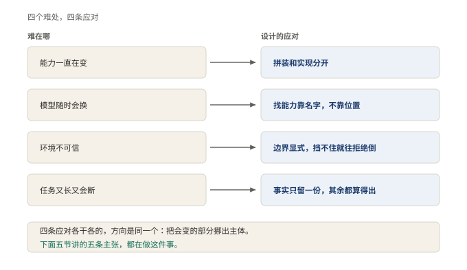
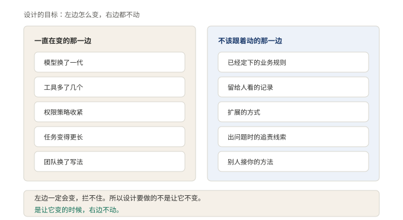

# §04 难在哪：能力在变、模型在换、环境不可信、任务还老断

前三节把对象说清了：模型外面那一圈，叫外壳，外壳里要管六件事。听上去，找几个人把这六件事办妥，不就完了？

开头往往真是这么顺。队伍刚拉起来，家伙就那几样，师傅就那一位，出了岔子收摊重开。三个月以后开始难受。这一节讲四道绕不过去的难处，只讲难处，不讲解法。解法是这本书后面五部的事。

## 4.1 小白版：队伍开张三个月以后

人马配齐了，师傅有人伺候了，头一个月跑得顺顺当当。然后四件事一件一件找上门。

第一件，活计的花样老变。今天修灯，明天修水管，后天有客户要自带一套进口家伙。每添一样家伙，领班的就得学一遍什么时候递它。

第二件，师傅老换。这行里师傅换得勤，几个月一茬。新师傅脑子一样好，可说话路数、做事习惯全不一样，人马得重新磨合一遍。

第三件，干活的地方不可信。师傅照着印象说「把里屋那扇窗打开」，里屋根本没有窗。更险的是，一句听着平平常常的吩咐，照着做能闯大祸。师傅不是使坏，他是真不知道这房子的边界在哪。

第四件，活又长又老断。一桩活一干大半天，中间会断电，干活的会被人临时叫走，记笔记的本子会写满。断了不要紧，怕的是接不上：明天来了，谁也不记得昨天干到哪。

自然的应对是领班的拿个小本，记满「碰到什么该怎么办」。这个办法撑不久。每添一样活计就得添一条，条目多了，谁也说不清哪条管哪条，改一条碰倒三条。再进一步，立一套正式的章程，家伙们都照章程打造。这步对，但不够：章程只管怎么动手，没管什么时候动手、砸了算谁的、不用了怎么请走。

**图 5：四道难处，道道绕不过去**〔本书〕

左栏这四道难处，没有一道能靠师傅更聪明来解决。右栏的应对先不展开，它们各自占着这本书后面的一整部。这一节只需要记住左栏。

## 4.2 专业版：四道难题的性质与排序

把人话换成术语，四道难处各有名字。

第一道，能力集合持续变化。工具从几样涨到几十样，还要接私有系统。能力每变一次，写死在循环里的调用就得跟着改一次。

第二道，模型更换。换代以月计，没有公司愿意绑死在一款模型上。各家的调用方式、返回格式、能力边界都不一样。换模型不是换一个地址，是重新适配一层。

第三道，环境不可信。模型会照着上下文编出一个不存在的路径，也会把一条看似无害的指令执行成灾难。它不是恶意，是不知道边界在哪。不知道边界，恰恰是最需要边界的情形。

第四道，长任务与中断。真实任务可能跑上几十分钟。中间网络会断，进程会被终止。上下文也会超出模型的记忆上限。断点续干不能指望模型的记性，它的记性是租来的。

硬撑为什么撑不住，值得说透。第一层硬撑是在循环里写分支，遇到什么调什么。每加一种能力就改一次循环。改的地方越多，改错的机会越多。改到后来，没人说得出循环的行为边界。第二层是抽接口、定规范。这一步是转折点，但它只回答了「怎么调用」。什么时候调用、失败算谁的、怎么拿掉，这三问它没答。后面三个问题，才是外壳真正的功课。

四道难题不并列，性质和后果差得很远。能力变化和模型更换是结构问题，决定这套东西能不能长大。环境不可信是安全问题，不常出，出一次可能收不住，决定这套东西敢不敢交出控制权。任务中断是持久化问题，决定这套东西能不能干长活。这本书的顺序也照这个轻重排：先讲结构，再讲边界，收尾讲怎么带走。

**图 6：目标不是让左边不变，是左边变的时候右边不动**〔本书〕

左边的事一定会发生：团队换人写法就变，模型出新版就得升，业务收紧权限就得调。右边的事不该被牵着走。定下的规矩、留给人看的记录、别人接进来的方法。这些每动一次都要付代价。让左边不变是做不到的，能做的只有一件事：左边变的时候，右边不动。这句话是整本书的判据，后面每条设计都能拿它验一遍。

难处摆完了。怎么让右边不动，是第 2 部开始的事。

## 4.3 两种说法的对照

本节新出现的说法，对应关系如下。

| 小白说法 | 专业术语 |
|---|---|
| 活计的花样老变 | 能力集合持续变化 |
| 师傅老换，人马重新磨合 | 模型更换与适配 |
| 师傅编出一个不存在的房间 | 幻觉（hallucination） |
| 本子写满了 | 上下文超出记忆上限 |

## 4.4 最容易理解错的地方

第一处：把四道难题当成并列的四件事，平均用力。错。它们性质不同：两道是结构问题，一道是安全问题，一道是持久化问题。安全问题不常出，出一次收不住；结构问题天天在付利息。用力顺序错了，投入全打水漂。

第二处：以为抽了接口、定了规范，难题就解决了。错。接口只回答怎么调用。什么时候调用、失败算谁的、怎么拿掉，这三问没有答案，难题一道都没少。

第三处：把设计目标定成「让会变的不再变」。错。左边那些事一定会发生，拦不住。目标是左边变的时候右边不动，不是左边不动。定错目标，所有努力都用在堵窟窿上。

## 4.5 这条能搬去哪

一个自查动作。找一个手头的项目，挑出最近加进去的一样能力，数一数为了加它动了几处地方。只动了登记的那一处，是及格；判断流程里、拦截规矩里、记账的地方各改一句，就是动了三处。改的处数，就是这个项目在四道难题上的成绩单。

<!-- FIGURES
图 5 fig-0-3-four-problems 〔本书〕
图 6 fig-0-4-what-changes 〔本书〕
-->
