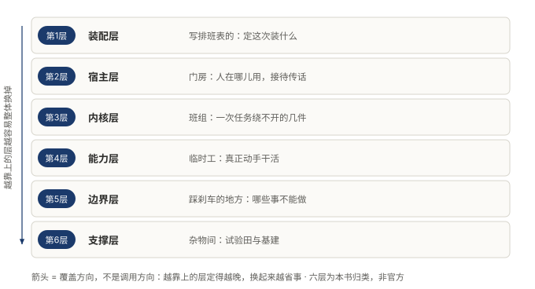
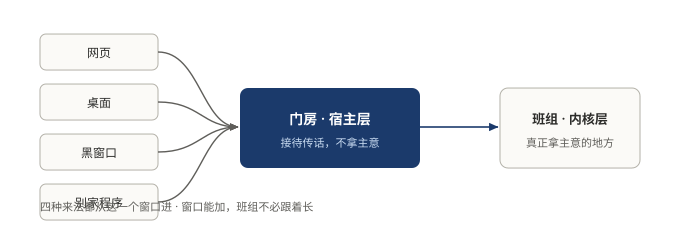
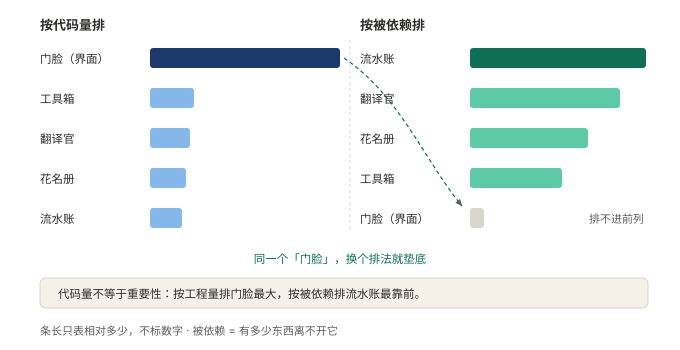

# §05 拆开它，六层各管什么

这套人马到底有多少人、怎么站？打开看，是一栋楼，六层。

这一节只干一件事：发楼层指引。哪层叫什么，哪层管什么，谁挨着谁。为什么这么切、切错了付什么代价，是下一部的事。先把地图拿到手，理由后面再补。

## 5.1 小白版：公司的六层楼

进一家陌生的公司，门房递来一张楼层指引。从下往上看。

地下室是总部最里面那一层。放的是换不出花样的东西：几点开工、本子往哪放、出了事留不留字条。哪家公司都差不多，所以没人去动它。它小，但整栋楼都压在它上头。

一楼是干活的班组。拧螺丝的、跑腿的、接外线的，全在这层。多雇一个班组，公司多一样手艺，地下室不用跟着动。检验也简单：加一样手艺要不要翻修地下室？要，就是楼盖错了。

班组旁边是安检口，比别的层都小。它的活只有一件：哪些事不许干。怎么把活干成，不归它管。刹车片从来比发动机小，这层最小，天经地义。

再往上是门房，对外的窗口。有人从网页来，有人从桌面来，有人从黑窗口来，还有别家的程序来敲门。四种来法，都从这一个窗口进。门房只管接待传话，从不替班组拿主意。

顶楼最小，只坐一个人：写排班表的。今天雇谁、用哪套编制，他一张纸写完就下班，别的一概不管。

最底下还有半层杂物间，堆着试用的家伙。看楼时可以略过，里面的东西下个季度可能就扔了。

**图 7：六层楼，每层只回答一个问题**〔本书〕

图里的箭头不是谁给谁打电话，是谁能换掉谁。越靠上的层，定得越晚，换起来越省事。别读反了：位置靠上不等于重要，只等于更能改。

**图 8：四种来法都从门房进，门房不拿主意**〔本书〕

窗口能加，地下室不必跟着长，这是楼层画对了的样子。画错了有典型症状：换一种接待方式，班组怎么干活就得跟着改。真到那一步，说明主意是门房拿的，越界了。

## 5.2 专业版：六层的名字和边界

六层的正式名字，从上到下：装配层、宿主层、内核层、能力层、边界层、支撑层。

各层的职责边界，一层一句话。

装配层只回答「这次装什么」。一份名单，不写业务，不持有状态。它小的理由是替换语义：凡是会按形态取不同值的东西，都不能住在这一层。

宿主层只回答「人在哪儿用」。四种客户端入口共用同一套内核。它是六层里工程量最大的一层，却一个决策都不做。

内核层是一次任务绕不开的几件东西。哪几件、为什么偏偏留下它们，第 3 部专门用一节讲。这里只给判据：删掉它，一次任务就进行不下去。

能力层是挂在循环下面的一排插孔，装哪个，agent 就多哪只手。边界层只回答「哪些事不能做」，策略、审批、受限执行都在这层。支撑层是试验田和杂物间，看架构时可以先剔掉。

哪层是楼的中心？数代码会数走眼。工程量最大的宿主层排不进中心，真中心是那个被指着最多的。依赖箭头指向谁，谁才是内核。

**图 9：谁是真内核看依赖方向，不看代码量**〔本书〕

两种排序完全不同：按工程量排，门脸最大；按被依赖排，记笔记的最靠前。代码量不等于重要性，出处就在这里。判断自己项目的内核也一样：别看哪个文件最长，看删掉它，多少东西活不下去。

这节只给地图。每条边界为什么这么画、画错一层付什么代价，第 3 部一层一层拆。现在只带走一句：每层只管一件事，不越界。越界的代价是同一个，本该只换一层的改动，蔓延成改多处。

## 5.3 两种说法的对照

| 小白说法 | 专业术语 |
|---|---|
| 六层楼 | 六层分层 |
| 地下室、总部最里面 | 内核层（kernel layer） |
| 干活的班组 | 能力层（capability layer） |
| 安检口 | 边界层（boundary layer：策略、审批、受限执行） |
| 门房、对外窗口 | 宿主层（host layer） |
| 顶楼写排班表的 | 装配层（assembly layer） |
| 杂物间 | 支撑层（support layer） |
| 谁指着谁 | 依赖方向 |

## 5.4 最容易理解错的地方

第一处：把位置靠上理解成更重要。靠上只说明定得晚、换得动。重要性看依赖方向，不看楼层高低。

第二处：把代码量最大的层当成核心。宿主层工程量最大，却一个决策不做。真内核是被指着最多的那层，往往小得不起眼。

第三处：把六层当成标准答案照抄。层数不必抄，判据才要抄：每层只回答一个问题；换掉层里一件东西，要动别层，就再切一刀。

## 5.5 这条能搬去哪

两个自查动作。

第一，翻出项目的入口，数一数几行在说「装什么」，几行在说「怎么干活」。两种话混在一处，装配层就没从别的层里分出来。

第二，给现有模块各写一句话：这层只回答什么问题。写不出来的那个，多半是两层的活挤在了一层，切层的第一刀就落在它身上。

<!-- FIGURES
图 7 fig-3-1-six-layers 〔本书〕
图 8 fig-3-3-host-entry 〔本书〕
图 9 fig-3-4-core-four 〔本书〕
-->
