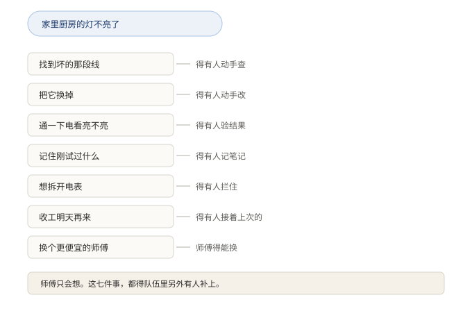
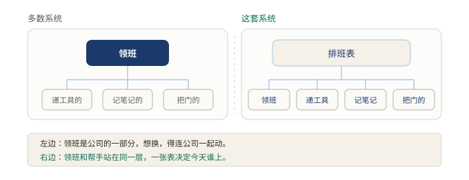
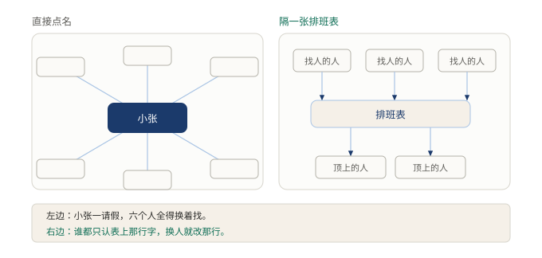

# §07 内核里是空的，连 agent 循环都是插件

每套软件里都有那么一个地方，动它之前得开会。

可能是订单主流程，可能是登录模块，可能是那段谁也不敢碰的历史代码。它未必是写得最好的部分，但一定是最难换的部分。改一次，别的模块跟着抖三抖。

DSH 里找不到这样一个地方。它最中心的那一层，可以整块拿走，别处一行都不用改。

这话凭什么成立？这一节分两层讲。第一层讲人话，第二层上术语。

## 7.1 小白版：一个只有脑子的师傅

家里厨房的灯不亮了，叫个修灯师傅。师傅到了，拎着一整套家伙：螺丝刀、万用表、梯子，还有个小本子。

先问一句：师傅最值钱的，是那套家伙，还是那颗脑子？

是脑子。螺丝刀谁都会拿，知道先拆哪一颗才难。

再反过来想：一个人只有脑子，没有手，修得好灯吗？修不好。他说「先断电，再拆开看看」，没人动手，等于没说。

AI 就是这么个情况。它知道该怎么干，但它自己够不着。所以想让它干活，得给它配一整套人马。

**图 13：师傅只会想，这七件事得队伍里另外有人补上**〔本书〕

这一整套人马有个名字，叫外壳。动手的有拧螺丝的，记事的有记笔记的，把关的有把门的，定下一步的有领班的。

中间领班最要紧。看情况、决定、动手、看结果、再决定，整个队的节奏全听他的。

大多数系统把领班焊死在公司最里面。这个选择有道理：领班换了，整个队的作风都变了，想让行为一致，就得把他攥在自己手里。代价也清楚：外面的人想要另一种节奏，只能等官方更新。等不到，就只好自己再开一家公司，重新雇一遍人。

DSH 的做法反过来。领班也是临时工，他和拧螺丝的、记笔记的站在同一层，由同一张排班表决定今天谁上。

**图 14：左边领班焊在公司里，右边他和帮手站平了**〔本书〕

左边想换领班，得连公司一起动。右边换领班，只改排班表上的一行。

公司最里面也不是全空着。剩下的是那些换了没意义的岗位：几点开工、本子往哪放、出了事留不留字条。这些东西哪家公司都差不多，换不出花样。凡是各家做法差别很大的，全被请了出去，一个不留。

怎么判断一个人是不是真能换？不能看他挂的工牌。有的岗位，工牌上印着「灵活编制」，可全公司每个人都直接点名找那个小张。小张一请假，全公司瘫。能用的判据只有一个：换掉他，要动几个人。

## 7.2 专业版：插件内核与改动半径

这套结构有个正式名字，叫插件内核。

它的核心机制是两条。

第一条，内核只留原语：时钟怎么取、日志往哪写、崩溃留不留现场。这些哪家做法都差不多，换不出花样，留着它们，系统才有个稳的底子。

第二条，其余一切都是插件。模型适配器、工具注册表、会话日志，以及 agent 循环本身，全由装配清单决定当前会话装哪些。官方的说法是：

> 产品的每一部分都是插件，包括模型适配器、工具注册表、会话日志，以及 agent 循环本身。
> ……不存在需要打补丁的特权内核。

插件之间不互相直连。消费方按名字要能力，装配层照着清单把名字兑现成实现。所以加一样能力，等于在清单里登记一行，内核一行不动。

**图 15：换掉它，要动几个地方**〔本书〕

左边那种结构里，中心模块被六处直接引用，改它牵动一片。右边那种结构里，消费方谁都不认识实现，只认识名单上的一行，换实现只改那一行。「能不能换」因此可以量化：换掉它要动几个地方，这个数字叫改动半径。DSH 的 agent 循环在右边，改动半径是一行配置。

这套设计的适用边界也要说清。

它换来两样东西。一是换得动：想要另一种循环，不必等官方。二是内核不长胖：留下来的只有换了没意义的原语，它们不是不想换，是换了没意义。

付出的代价是：装配清单自己不干活。读一遍清单，看不出系统在干什么，行为得从配置里重建。复杂度从实现方转移给了使用者。系统内部干净了，读懂它的成本往前挪了一步。

反过来也成立。把一切都收进内核，读者轻松，替换的灵活性交出去。两条路没有对错，只看愿意拿什么换什么。

## 7.3 两种说法的对照

前面两层说的是同一件事，用词不同。对应关系固定下来，后面各章直接混用，不再重复解释。

| 小白说法 | 专业术语 |
|---|---|
| 师傅的脑子 | 模型（model） |
| 一整套人马 | 外壳（harness） |
| 拧螺丝的 | 工具（tool：读文件、写文件、跑命令） |
| 记笔记的 | 会话记录（session log） |
| 把门的 | 权限与沙箱（permission、sandbox） |
| 领班的 | agent 循环（agent loop） |
| 临时工 | 插件（plugin） |
| 排班表 | 装配清单（assembly manifest） |
| 公司最里面那一层 | 内核（kernel） |
| 直接点名找小张 | 消费方直连实现 |
| 换掉他要动几个人 | 改动半径 |

## 7.4 最容易理解错的地方

第一处：把「一切皆插件」理解成「每个位子都有备胎」。它讲的是一件更窄的事——加一样能力，不必改内核。至于那个位子上有没有第二个实现可换，是另一回事，得看具体位置。

第二处：把「内核是空的」理解成「没有中心」。中心还在，只是里面只放换了没意义的原语。空的是特权，不是地方。

第三处：把「声明可插拔」当成「可以替换」。工牌上印着灵活不算数，多少人直接点名找小张才算数。改动半径是一行，才是真灵活。

第四处：以为循环是插件，就是说循环不重要。恰好相反。领班还是全队最要紧的岗位，只是这个岗位不再焊死。重要性和可替换性，是两回事。

## 7.5 这条能搬去哪

两个自查的动作。

第一，挑出系统里那个一请假全瘫的组件，数一数有多少处直接写了它的名字。数字越大，替换越是空话。

第二，判断一个组件该不该进内核，问的不是它重不重要，是它会不会被换。重要会骗人。财务系统很重要，可很多公司真换过财务系统。法务也很重要，同样换过。重要却很少被动的东西，才该待在内核里。

<!-- FIGURES
图 13 fig-07-a-seven-needs 〔本书〕
图 14 fig-07-b-empty-center 〔本书〕
图 15 fig-07-c-swap-radius 〔本书〕
-->
