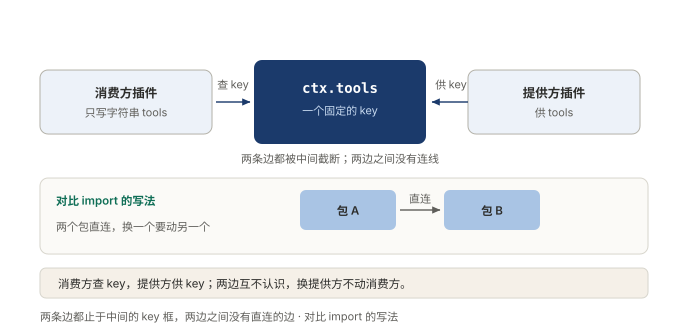
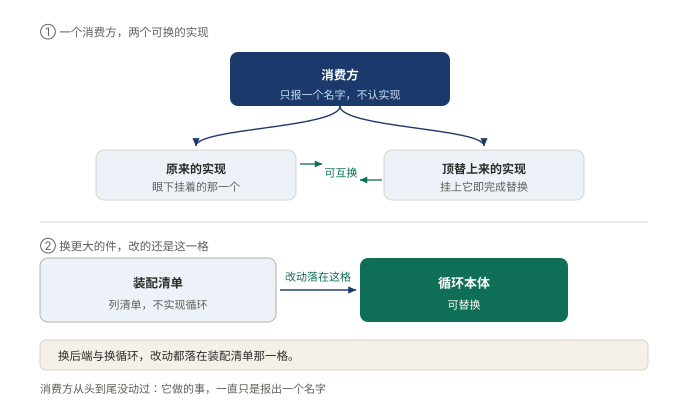

# §08 用一样能力，只写它的名字，不用管它在哪

上一节把话说绝了：公司最里面那一层是空的，连领班都是临时工。

话说得痛快，问题跟着来了。人都不固定，今天要拧螺丝，上哪儿找拧螺丝的？今天找到了，明天换人怎么办？

这一节就是答案：里面空了，靠名字找到人。第 3 部是一条链，划分、寻址、通信、生命周期、状态，这节是第二环，寻址。

## 8.1 小白版：报岗位名，不报人名

普通公司怎么找人？直接点名：这事找小张。小张在，事就成；小张请假，全公司翻通讯录，看谁也存了他的号码。

聪明的公司不这么干。它给每样活立一个岗位名：拧螺丝岗、记笔记岗、把门岗。要干活，只报岗位名，报完就完。岗上今天坐的是谁，归排班表管，表上写谁就是谁。

岗位名天天在，岗上的人可以天天换。

**图 16：两边只认岗位名，谁也不认识谁**〔本书〕

用活的人和干活的人之间不连线，各连各的，都连到岗位名上。名字不动，两边可以同时换。直接点名是另一种连法：那条线焊在两个人之间，换一个人，所有连过他的线都得重画。

还有一条硬规矩：先登记，后上岗。排班表上没登记的岗位名，报了也白报，当场驳回。岗位不是伸手就有，是先说清要靠谁，才轮得到谁。

这套规矩换来的是换人的自由。岗上的人换了，用活的那边一个字不用动。哪天要添个新岗位，也只往排班表上加一行，别人照旧干活。

## 8.2 专业版：服务键与按名查找

这套机制的正式说法：上下文是服务的容器，一个服务占一个稳定的名字，叫服务键。消费方按键查找，不导入具体实现。官方的表述：

> 其他插件通过 key 查找服务，而非导入具体实现。

核心机制三条。

第一，一个服务一个键。消费方写的是一个字符串，装配层照清单把键兑现成实现。键是契约，实现是库存。

第二，先声明，后使用。用哪个键，先写进自己的依赖声明里，没声明就读，当场抛错。声明之后不用再管顺序：谁提供谁先就绪，消费方一律排在提供方后头。加载顺序由依赖关系推出，不靠手工编排。

第三，替换发生在清单里，不发生在代码里。几个实现平级挂在同一个键下，谁被装上，谁就是当前那一个。

**图 17：换实现只动排班表，用活的一行不改**〔本书〕

名字活着，位置随时可以变。顶上来的第二个实现，甚至不必是真干活的那一个，也可以是个替身。排练时照着剧本念固定台词，用活的人毫无知觉。回放测试靠的就是这一手。

代价也要认三笔。所有键挤在一个平面上，起名得讲辨识度，常见的短名别去抢。运行时只认字符串，类型要靠另一层声明补齐，少了那层，代码照跑，报错迟到。再有，静态追不下去：读完代码答不出谁供的货，得去查装配清单。

适用边界就划在这。按名查找换来的是替换自由，押上的是一眼看穿的能力。行为散在清单和声明里，光读代码看不出谁在供谁。能力会被反复替换的项目，这笔买卖划算。只写死一种实现的小工具，直接引入一行就够，绕这个弯是白付成本。

名字立住，后面几环才接得上。公告栏认名字，拆装岗位也认名字。寻址是这条链的地基。

## 8.3 两种说法的对照

| 小白说法 | 专业术语 |
|---|---|
| 岗位名 | 服务键（service key） |
| 直接点名找小张 | 消费方直连实现 |
| 排班表 | 装配清单（assembly manifest） |
| 先登记，后上岗 | 先声明依赖，再按名读取 |
| 照着剧本念台词的替身 | 回放测试用的替身实现 |

## 8.4 最容易理解错的地方

第一处：以为报了名字随时能用。顺序是先声明后使用，没声明的名字当场抛错，能力不是伸手就有。

第二处：以为按名查找是白白绕路，不如直连痛快。查找本身不贵，贵的是直连焊死之后的替换：每换一次实现，惊动每一个引用方。

第三处：以为名字起完就一劳永逸。键是公共契约，挤在同一个平面上，占了别人的短名会撞车。起名跟立契约一样，得当回事。

## 8.5 这条能搬去哪

第一，挑出项目里最常被直接引用的那个类，数一数多少处写了它的名字。先给它立一个键，再让调用方改指这个键，替换才谈得上。顺序不能倒：名字先立起来，实现才有被换掉的资格。

第二，加新能力时问一句：调用方写的是一个名字，还是一个具体实现？是后者，替换那天就得挨家敲门。

<!-- FIGURES
图 16 fig-4-1-key-lookup 〔本书〕
图 17 fig-4-2-swap-backend 〔本书〕
-->
