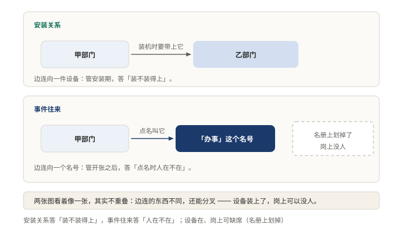
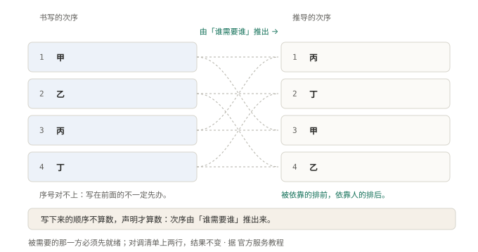

# §09 两个插件之间，为什么不直接喊话

人找到了，下一个问题是说话。

拧螺丝的要跟记笔记的打配合，最省事的办法是走过去直接喊。这条路，在这套人马里被堵死了：两个人之间不许连线，想说话，只能往大厅中间那块公告栏上贴。

为什么不许直接喊话？这一节回答这个。链条上的第三环：通信。

## 9.1 小白版：一块公告栏

这家公司的大厅中间立着一块公告栏。

谁有事要嚷嚷，写张条子贴上去：三楼灯修好了，下午要停电。贴的人不知道谁会来看，也不必知道。关心这事的人，自己过来看。

私下喊话是不行的。拧螺丝的不能走到记笔记的桌前，说把我刚才干的活记一笔。他只能往栏上贴：活干完了。记笔记的每天看栏，看到了就记。

**图 18：谁归谁管是一张图，谁跟谁说事是另一张**〔本书〕

花名册上挨着坐的两个人，栏上可能一句话都没有。栏上天天打交道的两个岗位，花名册上可能隔着三层楼。读透了谁归谁管，照样看不出谁在跟谁说事。通信是一张自己的图，跟汇报线不重叠。

绕这个弯，换回两样东西。一是加人自由：新来的临时工想看栏就看，不必先认识全公司的人。二是中途能插手：条子贴出来，把门的可以拦，这张不许贴，那张改两个字再贴。私下喊话做不到，话一出口就进了对方耳朵。

代价也明摆着。贴条子的人永远不知道谁看见了。站在栏前读一遍，答不出这话会落到谁手里。要答案，得去翻公告栏的登记簿。

## 9.2 专业版：事件总线与发布订阅

正式名字：事件总线，发布订阅。核心机制三条。

第一，横向只有一条路。插件之间不允许直接调用，想通信只能发事件。发布方不关心谁在听，订阅方不关心谁发的。

第二，一个事件一种模式。等不等接收方、算不算顺序、收不收返回值，三组开关定下走法。模式写在事件的契约里，不是发的时候临时挑。

第三，能改内容的只有一类。环绕式（waterfall）事件把「往下传」交到每个监听器手里：传，是委托给下一个；不传，是当场短路。能停链的那个，就是在替系统拿主意的那个，这个权力得写明归谁。官方教程的纪律很直白：只负责观察或标注的监听器必须往下传，不往下传、直接返回，代表有意短路。

**图 19：连开工次序都是推出来的，不靠私下协调**〔本书〕

左边是写下来的次序，右边是真正生效的次序，两列对不上。对不上才对：每个插件只声明开张前需要哪几样能力就绪，次序从这些声明里推出来，没有任何两个插件需要私下打电话排班。不喊话，协作照样排得整整齐齐。

为什么不用直接调用？直接调用把两个模块焊在一起。调用方写死接收方的名字和位置，接收方换实现、挪位置，调用方全得跟着改。而且一条直连的链上，中途没有下手的地方，拦不住，也审不了。走事件，耦合从人对人降级成人对栏。

代价同样要认。静态分析失效，读完代码答不出谁会响应，得查事件目录。短路不报错，该往下传的忘了传，系统只是少做一件事，日志是干净的。事件一多栏会吵，什么都往上贴，看栏的人就看不过来，事件目录得当公共契约管。

公告栏不是图省事。它把「谁认识谁」换成「谁关心什么」。耦合降一级，加人、拦事、换人三件贵事都变便宜。

## 9.3 两种说法的对照

| 小白说法 | 专业术语 |
|---|---|
| 公告栏 | 事件总线（event bus）、发布订阅 |
| 贴条子 | 发事件 |
| 看栏的人 | 监听器（listener） |
| 把门的拦条子 | 拦截事件 |
| 私下喊话 | 插件间直接调用 |
| 公告栏的登记簿 | 事件目录 |

## 9.4 最容易理解错的地方

第一处：以为公告栏只是把调用包了一层。少了模式这一层，所有事件退化成广播，谁说了算再也写不进代码。光有总线，只是把调用藏起来。

第二处：以为直连痛快，能直连就直连。直连省的是一次跳转，赔上的是两个模块焊死：中途想拦一刀，没有下手的地方。

第三处：以为监听器想停链就停链。停链是替系统拿主意，没决策权的必须往下传。忘了传不报错，是把下游整个吞掉，这个毛病最难查。

## 9.5 这条能搬去哪

第一，翻自己项目的事件清单，数有几个事件真能改写结果。答案是零，说明插件只能旁观，做不了主，总线形同虚设。

第二，给每个能改写结果的事件补一句：谁有权停链。写不出来的，说明决策权散落各处，出了事找不到归谁。

<!-- FIGURES
图 18 fig-5-3-two-graphs 〔本书〕
图 19 fig-5-1-inject-derived-order 〔本书〕
-->
