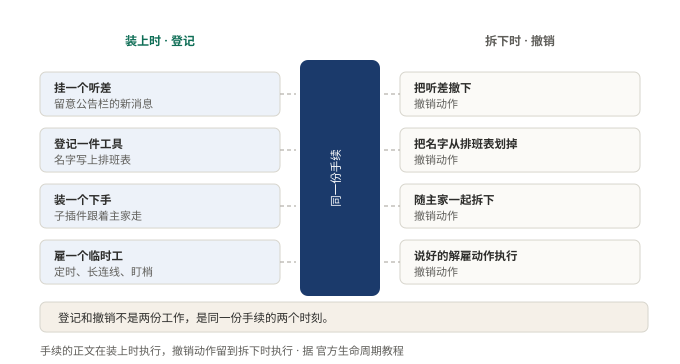
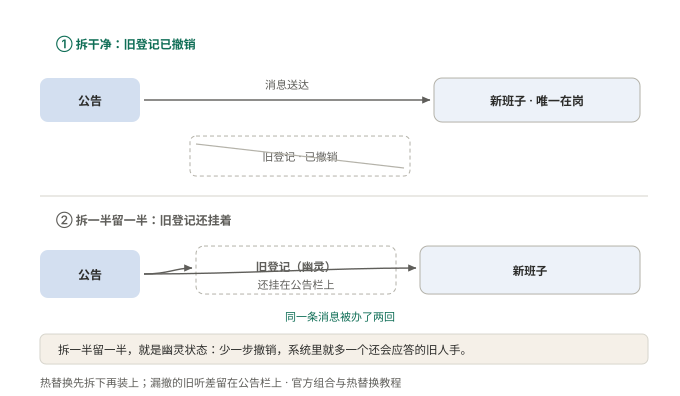

# §10 装上去的每一样，都要能干净地拆下来

一个临时工走了半年，他的门禁卡还能刷开公司大门。

听着像笑话，真出起事来不是。卡没回收，他半夜还能进来，进来还能坐在老工位上，替已经解散的项目组回邮件。楼里没人察觉，因为他做的每件事都像一个还在职的人。

这一节讲那张卡怎么收。前面几节讲了怎么装：要能力只写名字，喊话走公告栏。装得上去只是前半句，后半句是拆得下来，而且要拆干净。改一半留一半，是最坏的结果。

## 10.1 小白版：入职发的每一样，离职都要还

临时工入职，发的从来不只一张门禁卡。录了指纹，配了工位，还在公告栏边上给他安了个耳朵，楼里有动静他听得见。

离职那天，这些要一样一样还。卡要收，指纹要删，耳朵要摘。最怕的不是不办离职，是办了一半：卡收了，指纹没删，他能进大门却打不了卡，保安查三个月也查不出这人到底走没走。

这套人马里有条硬规矩：发东西和收东西写在同一张纸上。发的时候就把怎么收写好，两件事不许分开记。分开记，总有一天走散。

有人嫌麻烦：人都走了，补个手续不行吗。问题是半年后没人想得起来。当时不写清怎么收，收这件事就永远不会发生。

**图 20：发和收不是两份工，是同一张纸的正反两面**〔本书〕

左边是入职时发的，右边是离职时收的，中间是同一张登记表。一对一对得上，谁也不多出来。放在一处写，漏掉就变难了。

还有一种场合最容易留尾巴：改东西。这套人马改完一个临时工，做法是先辞退再重新雇，每保存一次跑一遍。要是每回辞退都留一样没收回，改十次，楼里就站着十个看不见的旧人。同一件事，十个人抢着应答。

**图 21：漏收一次，旧人还站在原处应答**〔本书〕

上面一行是收干净的：旧人离场，场上只剩一份应答。下面一行是漏收：新旧并排站着，公告一贴，两边都动。它从不报错，只是每件事多做一次。同一条记录冒了两遍，多半就是它；一重启症状消失，更是坐实。

## 10.2 专业版：注册是一件可逆的事

官方给注册下的定义只有一句：

> 注册是可逆的副作用。

意思是注册不是往表里添一行。它当场捎带生成一个撤销动作，两者写在同一处。装的那段，同时也是拆的那段。

机制分四条。

一，框架给的注册入口自带撤销。挂监听器、注册工具、装子插件，这几条都不必手写释放，登记的同时撤销已经生成。

二，框架管不到的要自己包。定时器、连接、文件监视器在这份名单里。把它们包进一段返回清理函数的逻辑，收工时就会被叫到。

三，卸载是过程，不是瞬间。插件从可用走到终态，中间必经卸载段，所有释放动作结算完才落地。终点可查询；对着已卸载的再注册，会当场报错。报错比留幽灵好，它至少肯声张。释放的顺序反着来：后建的先拆。

四，触发卸载的场合有四种。配置改一行、提供方整体更换、显式释放、热重载。第三种最容易漏算：名字背后的人换了，依赖他的要整段重建，放进去的每一样都得能回卷。

代价写在插件作者那边。每放一样东西进去，就得想清楚还什么；想不出该还什么，这一步多半不该写。幽灵状态的麻烦在于它不报错，只是多做一次，往往要到重启那天才被看见。

## 10.3 两种说法的对照

| 小白说法 | 专业术语 |
|---|---|
| 门禁卡、指纹、耳朵 | 注册捎带的副作用 |
| 离职一样样还 | 卸载时执行撤销（disposer） |
| 同一张纸 | 注册与撤销写在一处的 effect |
| 看不见的旧人 | 幽灵状态（ghost state） |
| 先辞退再重新雇 | 热重载（先卸载再加载） |

## 10.4 最容易理解错的地方

第一处：以为卸载是罕见动作，平时用不上。恰好相反，四种触发场合里热重载天天发生。每保存一次就是一轮辞退再雇，留一份，再留一份。

第二处：以为改一半留一半只是不太干净。它是最坏的结果，比完全不拆还糟。完全不拆，旧人好歹有名有份；拆一半，他成了没名没份还能干活的影子。

第三处：以为出了问题总会报错。幽灵从不报错。同一件事被处理两次，同一条日志冒两遍，重启之后症状消失，这三条凑齐，就是它在场。

## 10.5 这条能搬去哪

两道自查。

一，把系统里每一处「放进去」列出来，逐个问它怎么拿出来。答不出的那些，就是将来的幽灵。

二，做一次卸了再装，看行为和第一次是不是完全一样。不一样，说明有东西落在了外面。

两条都答得出，热插拔才敢开。答不出，重启就是唯一的清理手段。

<!-- FIGURES
图 20 fig-7-1-load-unload-symmetry 〔本书〕
图 21 fig-7-2-ghost-state 〔本书〕
-->
