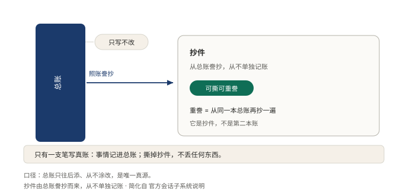
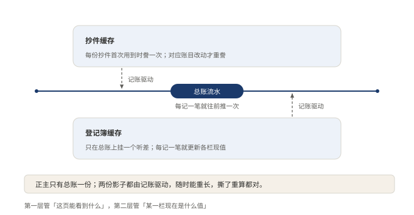

# §11 同一件事，为什么只能存一份

一家公司记两本账，是最让查账人睡不着的事。

月初两本一模一样，月底必然对不上。对不上之后，最难受的不是改账，是从此答不出当时到底发生了什么。

这一节是第 3 部的收束：状态放哪。答案很短。同一件事只许有一个正主，别处的都是照着它长出来的影子。影子可以扔，正主不能丢。

## 11.1 小白版：全公司只有一本总账

规矩是这样。全公司只有一本总账，锁在记笔记的手里。师傅说了什么，拧螺丝的干了什么，全按先后落进去，只往后添，不改旧的。

各部门手里也有账，但都是抄件。给师傅看的那份对话记录，是照着总账现抄的；给人看的那份工作报告，也是照着总账现抄的。抄件不单独存档，用完可以扔，扔了照总账再抄一份，一个字不差。

最怕的是抄件被当成正主，往上添了两笔。添完，它和总账就分了岔，从此谁也说不清哪本是真的。

只认一本总账，换来两件值钱的东西。

一件是复盘。出了事，把总账从头到尾再念一遍，当时什么样，念出来就是什么样。另一件是接续。笔记复印一份，从那一页接着写，另一个摊子就能从同一个地方开张。这两件事成立，全靠正主只有一处：从哪一页抄，谁都对得上。

**图 22：总账站着，对话记录只是它算出的一张抄件**〔本书〕

箭头只有一条：动静落进总账，抄件从里头算。右边那张是虚线的，意思是删了不丢东西，重算一遍就回来。别处常存两份，一份对话一份流水，开头相同，后来分岔；这里没这个烦恼，答案只有一处。

现抄不是免费的。每看一回，都得把总账再念一遍。这套人马垫了两层草稿压着：一层记着这一页能看到什么，内容变了才重抄；一层记着某件事现在到哪了，来一条新记录添一笔。草稿随时能扔，扔了重抄，丢不了正主。

**图 23：两层草稿压住现抄的开销，扔了重抄都对**〔本书〕

两层草稿都挂在总账的流水上，来一条动一笔。这是它们和正主的分界：草稿是算出来的，总账是落下去的。

## 11.2 专业版：日志是唯一事实源

这套设计的正式说法叫单一事实源：会话是一份仅追加的事件日志，其余一切状态从它派生。官方把话说得很死：

> …LLM 消息历史从日志派生而来，从不单独存储；回放即从同一组事件重新派生。

机制分四条。

一，写路径只有一条。事件进来，追加到日志末尾，就此封存。不改旧的，不插中间。

二，读路径全是投影。给模型看的消息历史、给人看的记录、给统计看的数值，各是一张投影，取自同一处。删掉任何一张，不丢任何东西。

三，回放、分叉、恢复因此成立。重放同一组事件就能回到当时；从任意一页切开就是一次分叉。存状态的系统要为这些需求各补一套机制，存事件的系统天生就有。

四，开销靠两层缓存压住。一层管某个切面当前长什么样，内容变了才重建；一层管某个关注点当前的值，靠订阅事件增量更新。两层都由事件驱动，都可丢可重建。客户端拿到的是算好的成品，不自己折事件。

边界也要说清。只往后写把并发冲突收窄到末尾的序号，不是归零；序号一断，缺口看得见，但缺口还是要人去补。每读一次都要重算一遍，这笔开销在算得快比算得准要紧的地方压不住。还有一层心智负担：写的人常忘了手里的数据不是本身，读的人容易把投影当原物。

另有一条配套规矩。有些事件在某个部署里本就不产生后果，处理它的那段什么都不做。不做没问题，不写下来才是问题：空实现必须说明自己为什么空。日志是唯一真源，真源上一段沉默的缺口，回放出来的结果就是错的。

## 11.3 两种说法的对照

| 小白说法 | 专业术语 |
|---|---|
| 总账 | 仅追加的会话日志，唯一事实源 |
| 抄件 | 派生状态（投影） |
| 照总账再念一遍 | 回放（replay） |
| 两层草稿 | 派生缓存 |

## 11.4 最容易理解错的地方

第一处：以为存两份更保险，一份坏了还有一份。两份一开始相同，后来必然分岔；分岔之后，「当时发生了什么」再也答不出。

第二处：以为影子删了，东西就丢了。恰好相反，影子随便删，删了从正主重长。真正不能丢的是正主。

第三处：以为只往后写就没有并发问题。冲突没有消失，是收窄到了末尾的序号。序号连着，缺口一眼看得见，但看得见不等于没有。

## 11.5 这条能搬去哪

判断很短：凡是要重来一次的系统，都值这笔账。回放、分叉、事后复盘，有一样需要，就值。

检验也只有一句。把系统里所有算出来的数据全删掉，看能不能从原始记录完整重建。能，才叫只存一份；不能，那两份里迟早有一份变成没人敢认的账。

<!-- FIGURES
图 22 fig-14-1-log-is-truth 〔本书〕
图 23 fig-14-2-derivation-cost 〔本书〕
-->
