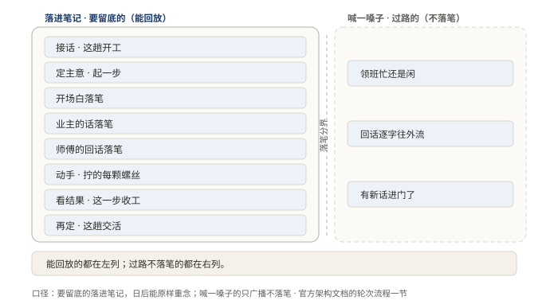
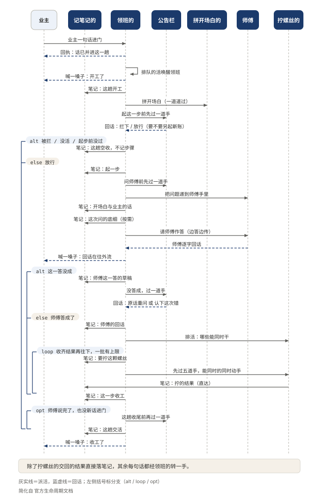
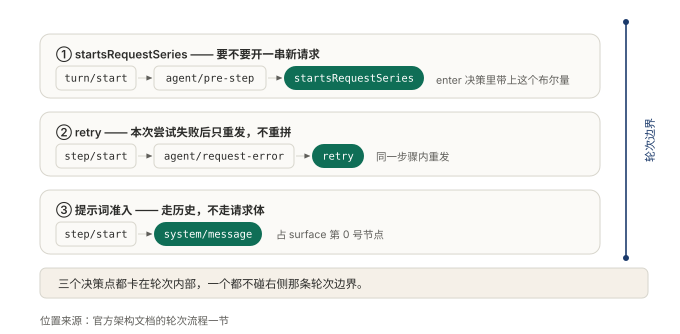

# §12 一句问话进来，中间经过了谁

前面几节把零件一件件拆开摆在桌上了：怎么找人的，怎么喊话的，怎么辞退的，账怎么记的。这一节把它们装回去，通一次电，看一句「灯不亮」从进门到交活，中间都经过谁。

## 12.1 小白版：师傅修灯的一整天

业主一句话进来：「灯不亮。」

领班的接活。先翻笔记，看这家以前修过什么，再想想这趟该带谁。到了现场，节奏是他定的：看情况，灯不亮；决定，先查开关；叫拧螺丝的动手；看结果，没电到；再决定，拆灯座。中间每一步，记笔记的在旁边落笔。灯亮了，业主点头，这趟活才算交。

这里有两把尺子，别混。拧一颗螺丝是一步，从进门到交活是一趟。一趟里几步不一定，也许一步，也许十步。判断这趟完没完，不看师傅说没说完，看还欠不欠活：拧螺丝的没收工，外援没交差，这趟就关不上。要取消，按一趟取；要重来，按一步来。两个动作各有各的粒度，互不迁就。

还有一路分工容易看漏。记笔记的和喊话的各管一摊。要留底的，落进笔记；只是让旁人知道进度的，往公告栏喊一嗓子，不落笔。分开不是图省事：笔记要的是日后能原样重念，进度要的是当下立刻听见。混在一起，听进度的得等落笔，笔记也会被闲话淹掉。判定标准只有一条：这句话以后要不要用来还原现场。

**图 24：要还原现场的落进笔记，过路的只喊一嗓子**〔本书〕

左列是要留底的，右列是过路的。日后要复盘，读左边；界面上要跟进度，订右边。这条分界，这一节后面每一步都能对上号。

全队这么多人，指挥只有一个。领班的领活、定路、派人、记节点，其余各方听他调。为什么不设两个指挥？因为一趟活日后要能原样重念。指挥有两个，重念时就得先猜当天谁先开的口，念出来的就不是原来那一趟。

**图 25：七双手在场，指挥只有一个**〔本书〕

图上各家各站各位，主干只有一条。多问一句也能看出讲究：除了拧螺丝的交回的结果直接落笔记，其余每句话都经领班的转一手。多绕一道，换的是笔记里先后次序的确定性。

一趟里还埋着三个岔路口，全卡在一步之内，不碰一趟的边界。

**图 26：三个岔路口都卡在一步里，一趟的边界一个不碰**〔本书〕

第一个，要不要起一本新账：笔记太厚了，誊成一页纸，从这里另起。第二个，这一步没办成，重来一遍：只把同一句话再问一次，不重新盘算问什么。第三个，开场白怎么递：不塞进表格的格子里，单独记成笔记的头一条。三个决定当时不记清，事后誊抄和重念都对不上。

## 12.2 专业版：轮次、步骤与一个指挥

官方给两个尺度下的定义是：

> 一个步骤是一次模型请求加上它调用的工具。一个轮次包含零个或多个步骤：它在领取首条输入之前打开，并在不再欠下任何工作时关闭。

机制分四条。

一，两个尺度回答两个问题。步骤问「模型该答什么」，轮次问「这件事还有没有欠账」。轮次的关闭条件不是「答完了」，是「不再欠下任何工作」：工具结果没回来，子代理没交差，轮次就关不上。取消挂在轮次上，重试挂在步骤上，各有各的落点。

二，零步轮次是正常形态。输入被拒、首批为空、准备阶段失败，轮次开了又关，中间一步不记。

三，事件分两路。写进会话日志的是持久事实，只在进程里广播的是实时信号。回放要确定性，界面要即时，混进一个通道两头都受损。判定标准：这条信息以后要不要用来还原现场。

四，单一指挥。驱动器领输入、拼提示词、发请求、派工具、写日志。除工具结果直达日志，其余每条消息都经它转发，用多绕的一道换日志顺序的确定性。三个决策点都卡在步骤内部：要不要开新请求序列（压缩和回放按序列切段，边界当时不记，事后拼不回来）；失败后重试只重发不重拼（重拼换掉问题本身，就不叫重试）；提示词走一条系统消息事件，占消息历史的头一个位置（模型看到什么，日志里就记着什么，请求才从日志还原得出）。

代价也直说。多一层转发，多一层延迟；两个尺度的概念，每个接进来的人都要先学一遍。

## 12.3 两种说法的对照

| 小白说法 | 专业术语 |
|---|---|
| 一趟活 | 轮次（turn） |
| 一步 | 步骤（step） |
| 落进笔记 | 写进会话日志的持久事件 |
| 喊一嗓子 | 只广播的实时信号 |
| 领班的（本节） | 驱动器（driver） |
| 起一本新账 | 开一串新请求序列 |

## 12.4 最容易理解错的地方

第一处：以为轮次关闭就是答完了。关闭的条件是没有欠账。师傅话说完了，拧螺丝的还没收工，这趟照样关不上。

第二处：以为开了轮次必有步骤。被拒的、空的、准备就失败的，都是开了又关的零步轮次，不是异常。

第三处：以为重试是把这一步从头再来。重试只重发同一个问题。重新盘算问什么，等于悄悄换了问题，那不叫重试，叫另起一步。

第四处：以为实时信号不落盘是丢了信息。界面重连时按快照重建，不必重放；让它落盘，只会拖慢每一次转发。

## 12.5 这条能搬去哪

这套尺子不只属于对话系统。批处理管道、工单流转、离线任务队列，凡是「一次请求带出一串后续动作」的地方，都需要两个收敛条件：一步做完，一件事办完。

检验很短。问一句：谁说了算「不再欠下任何工作」？答不上来，就是缺了轮次这一层，取消、计费、回放全都没有落点。

<!-- FIGURES
图 24 fig-12-1-turn-skeleton 〔本书〕
图 25 fig-12-2-turn-sequence 〔本书〕
图 26 fig-12-3-three-decisions 〔本书〕
-->
