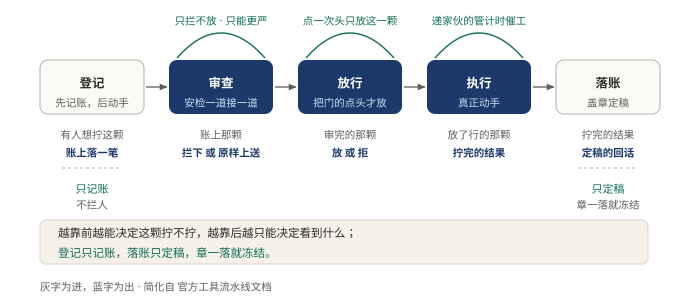
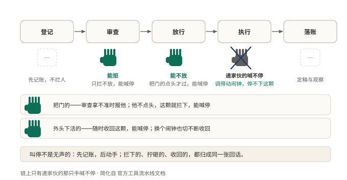
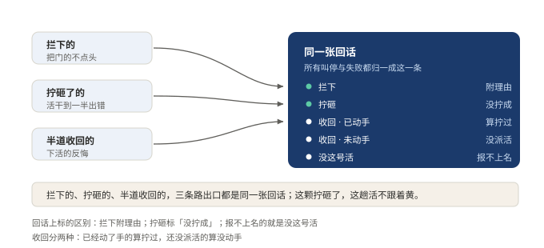

# §13 一次工具调用，要过哪五道工序

全队上下，只有拧螺丝的真碰东西。

师傅说错一句话，顶多答错；拧螺丝的拧错一颗，收不回来。写文件、跑命令、动外面的系统，全经他的手。所以这颗螺丝不能他想拧就拧。从「想拧」到「拧完」，中间要过五道手，每一道都有权说一句「这颗不许拧」。

奇怪的地方在这：这五道不是五个步骤，是五种权力。

## 13.1 小白版：一颗螺丝过五道手

第一道手问：这颗让不让拧。可以放行，可以拦下；拿不准的，报给把门的等人点头。点一次头，只放这一颗。

第二道手是安检，可能不止一条。每条安检只有一个权力：更严。谁也不能把前面拦下的又放回去。所以安检先来后到无所谓，谁先查，结论都一样。

第三道手才真正动手。他边上站着个递家伙的，管计时、管催工、管记数。这个人调得动手里的闹钟，喊不停这颗螺丝。为什么单把他拎出来说？安检管的是该不该，他管的是快不快。让他能喊停，等于让闹钟替安检做决定。

第四道手管拧完给人看什么。活干成了，能交代一句「拧好了」，也能换个说法。但换说法只是面上好看，藏不住事；真要藏，只能在前头拦下。

第五道手盖章定稿。章一落，这份回话就冻结了，往后只许看，不许改，连盖章的自己也不能再碰。

**图 27：五道手各有各的否决权，越靠后越只能决定看到什么**〔本书〕

越靠前的，越能决定做不做；越靠后的，越只能决定看到什么。排队是有讲究的：拦人的排前头，传话的排后头。

还有一条铁律：先记账，后动手。螺丝还没碰，记笔记的先把「有人要拧这颗」落下来。后面不管走到哪一道，这笔账都在。拦下了也不撕掉，拦的理由就是交回去的话。

**图 28：能喊停的手有好几只，递家伙的那只不在其中**〔本书〕

头一道能拦，安检能补刀，把门的能拒，外头下活的人随时能收回。唯独递家伙的喊不停：他换得动闹钟，换不动这颗螺丝的身份。

叫停、出错、反悔，三条路看着不一样，出口只有一个。

**图 29：三种叫停，出口是同一张回话**〔本书〕

拦下的、拧砸了的、半道收回的，末了都归一成同一张回话，区别只在上面标的原因。好处在下游：记账的、传话的、算工分的，只认一种格式。还有一条规矩：这颗螺丝拧砸了，这趟活不跟着黄。

## 13.2 专业版：五段流水线

为什么不做成一次函数调用？因为工具调用要三件事同时成立：可拦、可改、可追责。拦和改是两种权力，塞进一个函数就分不清谁说了算。还有一个实际理由：工具的种类会一直加，流水线把新增的成本挪到了注册一处。

五段各管一件事。

一，pre。四种结论：放行、拒绝、取消、转审批。审批只有「授权这一次」才继续，其余一律变拒绝。反直觉的一条：参数在这段不能被改写，历史、审计、界面、执行必须看到同一份参数，改一处就四处对不上。

二，guards。单调收紧：返回里没有「放行」这一档，不返回就保留上层的决定，返回理由就只能是拒绝。任何监听器都没法把别人拒掉的调用翻回来，所以策略叠加与顺序无关，装配顺序不会变成业务逻辑。

三，execute。包装层管超时、重试、指标，改得动取消信号，改不动这次调用的身份；注册表在进函数体前重新融合信号，换信号切不断取消。

四，post。能换内容也能换值，二选一。换内容，规范值原样留着；换值，内容重新算。内容替换是展示策略，不是保密策略。

五，finalize。同步、只碰内容、必须不抛，每个归一化结果只跑一次。为什么必须不抛？下游已经拿到冻结的权威结果，留一个能抛的余地，等于给观察者开一个改结论的后门。

痕迹有两条规矩。调用派发之前先落一条日志，先记账后动手；拒绝、异常、取消都归一成同一条工具结果，区别只在错误码，调用失败但不终止当前轮次。

代价也摆着。五段的概念，每个工具作者都要学一遍；一个简单的工具接入一条重流水线，显得兴师动众。换来的是出错时每一步都能拦、能改、能追责。

## 13.3 两种说法的对照

| 小白说法 | 专业术语 |
|---|---|
| 五道手 | 流水线五段（pre / guards / execute / post / finalize） |
| 安检只能更严 | 单调收紧（guards 无放行档） |
| 递家伙的 | 包装层（超时、重试、指标） |
| 盖章定稿 | finalize 冻结权威结果 |
| 先记账，后动手 | 派发前先落调用日志 |

## 13.4 最容易理解错的地方

第一处：以为五段是五个步骤，各干各的活。它们是五种权力，排的是谁能说了算。看一段，先看它能改什么、不能改什么。

第二处：以为第一道手能顺手把参数改漂亮点。不能。参数一改，记录、审计、界面、执行四处对不上账。

第三处：以为结果段换个说法就能把敏感内容藏住。内容替换只管展示，程序化的值原样还在。想藏，只能拦下或换值。

第四处：以为多条策略叠加要精心排顺序。要排序的设计才危险：顺序一旦影响结论，改一行配置就换一种行为。单调收紧就是用来把顺序从结论里拿掉的。

## 13.5 这条能搬去哪

任何会碰外部世界的动作，都值得配这样一条链。判断标准不是段数，是三件事分没分开：做不做、干了什么、看到什么。

搬的时候先问：链上有没有一段是只能收紧的？没有这一段，策略叠加就得靠排序，靠排序迟早出事。更省事的搬法是先只做收紧段和定稿段，一个管叠加，一个管出口，改动最小，见效最快。

<!-- FIGURES
图 27 fig-13-1-five-stages 〔本书〕
图 28 fig-13-2-who-can-abort 〔本书〕
图 29 fig-13-3-trace-lands 〔本书〕
-->
