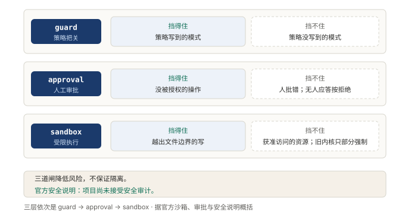
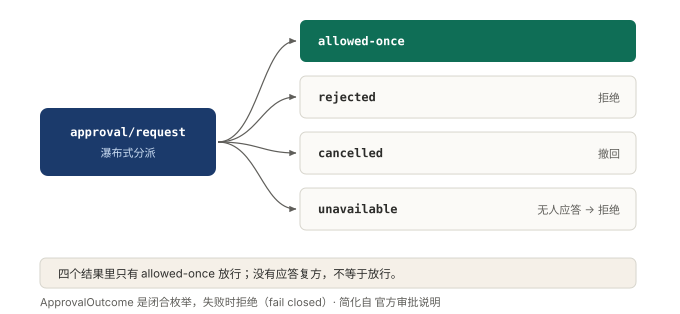
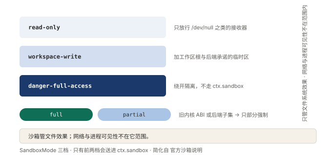

# §14 它被允许碰什么：三道闸

队伍再能干，进门前也得先回答一个问题：这家人让碰什么。

AI 的脑子不知道哪一步越线。它拿到手的默认能力是什么都能试，越线的判断只能由外面给。同一句话再问一遍，它给出的走法还可能不一样。指望它自己守住边界，等于没守。

所以边界要画在队伍这一侧，画成三道闸。这一节正着讲：权限怎么收，什么要等人点头，干活的范围围在哪。

## 14.1 小白版：把门的只管三件事

装修队进小区，先过大门口。进门收钥匙：电钻、切割机这类危险家伙，默认一件都不许带，要用，一样一样申请。顺序很要紧。不是先全放进去再往外挑，是先全挡住，再一样一样发。

第二道卡在业主身上。有些活不是不能干，是不能自己说了算。砸墙、动燃气，干之前必须业主签字，签一次只管这一次。业主没回话怎么办？就当没签。没人点头不算同意，这是全部规矩里最要紧的一条。

第三道卡在施工现场。警戒线一拉，活只能在线里干。围多宽分三档：只让看不让动，让在屋里动，或者干脆不围。警戒线围得住东西，围不住人站在线里往外打电话。

**图 30：三道闸各挡一块，漏掉的地方互不补位**〔本书〕

图里三行就是一次活要过的顺序。每行左边写挡得住什么，右边写挡不住什么。右边三格竖着读：收钥匙管不了业主乱签字，签字管不了线外的东西，警戒线管不了线上的喊话。三道叠起来不是铜墙铁壁，是三块各挡一摊的板。

物业把丑话说在前头：这三道卡是减风险的，不担保不出事。记住这句，下一节要考。

## 14.2 专业版：收紧、审批、隔离

三道闸的正式名字是权限收紧、人工审批、沙箱隔离。它们合起来只做一件事：把默认状态从放行翻成不放行。

收紧翻的是默认权限。默认姿态是只读，故障安全：能力一项一项授，不是先全开再一项一项收。策略写到的危险模式当场拦下，并附一条拒绝理由。被拦的调用带着理由回到模型，模型照着换一条路。拒绝给理由是最省事的一笔，它把一次拦截变成一次提醒。

审批翻的是这一次能不能干。结果集合是闭合的：授权这一次、拒绝、取消、无人应答，四格里只有一格放行。无人应答落在拒绝那一侧，这叫失败闭合：系统挡不住的时候倒向拒绝，不倒向放行。每次审批留一对审计事件，问了什么、定了什么各记一笔，只进日志，不进模型看到的对话。

隔离翻的是干活时能碰到什么。三档模式，从只读，到放开工作区，到绕开隔离。它管的是文件效果，网络与进程可见性不在定义范围内。强制完整性由后端报告，分完整与部分两档；报部分时，要求绝对保证的消费方必须拒绝。没有可用后端时直接拒绝，不透传。静默的无隔离透传永远不合法。宁可干不了，也不假装在干。

官方自己先把话说死：

> 沙箱、审批提示与权限控制可以降低风险，但不保证隔离，也不能保证防止损害。

还有一句更硬的：这是实验性的开发者预览软件，没经过安全审计，不得当生产可用的软件来用。

**图 31：四个结果里只有一个放行，没人应答也算拒绝**〔本书〕

中间是分派口，右边四个结果。唯一放行的那格是授权这一次，只放行所问的那一个操作。其余三格全归拒绝，无人应答也落在这一侧。审批最容易出的漏洞不是批错，是没人应答时那个默认值。

收紧和隔离各有一个旋钮，彼此独立，可以任意组合。面向用户时两个旋钮捆成一个开关，一次切换也记一笔。分开摆，用户得先懂两件事才能做一次选择；捆起来，一次选择就是一套立场。

**图 32：名字叫沙箱，管住的只有文件效果这一摊**〔本书〕

三档从上到下放宽，右边一列是它的边界：文件效果在界内，网络与进程在界外。下面两枚徽标是强制完整性的两档，报部分的那档等价于没保证。名字叫沙箱，别按名字想象它的管辖范围。

## 14.3 两种说法的对照

| 小白说法 | 专业术语 |
|---|---|
| 进门收钥匙，一样一样申请 | 权限收紧，能力逐项授予 |
| 只让看不让动 | 默认只读（read-only） |
| 业主签字，签一次管一次 | 人工审批，授权这一次 |
| 没回话就当没签 | 失败闭合（fail-closed） |
| 警戒线 | 沙箱隔离 |
| 给一张纸条说为什么不给 | 拒绝理由 |

## 14.4 最容易理解错的地方

第一处：把三道闸当成一道厚墙。三道的漏洞不重叠，叠起来才值；但它们互不补位，官方明说三道加在一起也不保证隔离。

第二处：以为审批的风险在于批错。审批最大的漏洞是没人应答时的默认值。没人应就放行，审批等于没装。

第三处：以为沙箱管住整个环境。它只管文件效果，网络与进程在定义之外。名字叫沙箱，管的只有一摊。

第四处：以为收紧就是拦得多。收紧是默认不发。清单之外全是空白，宁可漏拦一次已知的，也别假装清单完备。

## 14.5 这条能搬去哪

三个自查动作。第一，挑出系统里的危险操作，看它的默认状态是全开再收，还是全收再放；是前者，先翻过来。第二，找到需要人点头的环节，问没人应答时倒向哪一侧。第三，看拦截给不给理由；不给理由的拦截是死路，给了理由的拦截是提醒。

搬的顺序也有讲究。先把默认翻成拒绝，再补审批，末了才是隔离。前一道没立住，后一道就是空的。

为什么这么设计？边界一旦靠默认放行撑着，出事那一刻没人兜底。能搬去哪？任何会给模型发工具的系统，都先把默认状态翻成拒绝，再谈别的优化。

<!-- FIGURES
图 30 fig-16-1-three-layers 〔本书〕
图 31 fig-16-2-approval-outcomes 〔本书〕
图 32 fig-16-3-sandbox-modes 〔本书〕
-->
