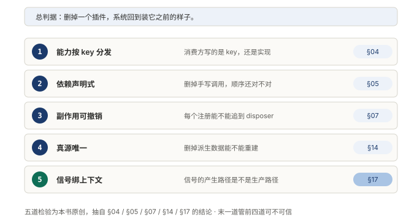
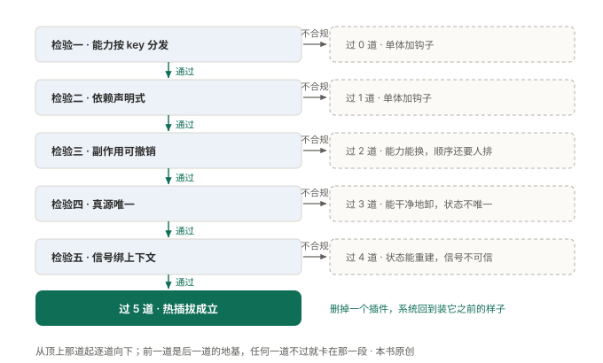
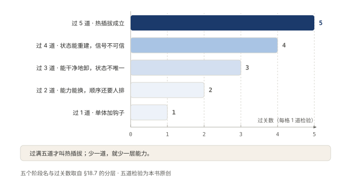

# §16 不看代码，怎么知道它真的做到了

拆开机器数齿轮是一种验法。不拆，也能验。

总判据只有一句：删掉一个插件，系统回到装它之前的样子。它好在当场能验：挑一个，删掉，看有没有残留。五条判据各查一个侧面，能力、依赖、撤销、真源、信号，一样一条，互不重叠。用法也有讲究：别一次改五处，一条一条过。每过一条，可替换的程度就高一层。

## 16.1 小白版：五个当场能做的试验

一支装修队靠不靠谱，不用翻它的账本，做五个试验就知道。

试验一，换掉一个帮手，看要通知几个人。只改排班表上的一行，靠谱；挨个打电话通知，不靠谱。

试验二，把排班表上的顺序擦掉，看早上还能不能自己站好队。每人只写过一句「我需要谁」，队形就能自己推出来。擦掉就乱，说明顺序是背下来的。背的东西最怕加人。

试验三，请走一个人，看他交没交干净。钥匙、对讲机、门禁卡全交回，工位恢复原样，才算走完。交不干净，新人来了，同一件事两个人管，一件事干两遍。

试验四，把誊出来的纸全撕了，看能不能从底稿重新誊一份。能，说明底稿只有一本。不能，说明有两本底稿，两本迟早对不上。

试验五，别信奖状，先看奖状是哪场比赛发的。彩排发的奖状，证明不了正式上场。

**图 36：五个试验各查一处，没有两个查同一件事**〔本书〕

五个排成一列，各管一处：换不换得动、排不排得对、退不退得净、恢不恢得回、信不信得过。竖着读一遍，查的确实是五样不同的东西。

## 16.2 专业版：五条判据与一条链

判据一：换掉后端，消费方动不动。动作：挑一项能力换掉提供方，数要改几处。合格：消费方一行不动，它写下的是能力的名字，不是提供方的实现。还有一条硬信号：读一个没声明过的名字，应当当场抛错。这条排第一不是随意的，耦合朝着实现走，后面四条都无从谈起。

判据二：删掉手写顺序，还能不能排对。动作：删掉启动脚本里那串手写调用。合格：插件只声明「需要谁」，系统推出提供方在前、消费方在后，配置里两行对调，输出不变。不合格：一张手工排班表，加一个依赖得回去改表。还有一发暗雷：声明的服务缺席时系统不报错，插件停在等待态，什么也不做。

判据三：每个注册追不追得到一个撤销。动作：挑一个注册往上追。合格：注册挂在当前作用域上，撤销和注册共用一份代码，定时器、连接、监听器也包进去。不合格：卸不干净，旧监听器还挂在总线上，新实例又注册一份，同一件事被处理两次。热重载是这条判据的压力测试，改十次文件，进程里不该多留十份。

判据四：删掉派生数据，能不能重建。动作：把派生出来的状态全删了，看能不能从事件重新算回来。合格：真源只有一份，日志是事实，消息历史是投影，删了随时能再算。不合格：对话历史存一份，事件日志存一份，两份真源迟早对不上。只有一份真源，卸载才有参照，才说得清回到装它之前是什么样。

判据五：这个信号产自哪条路。动作：挑一个最绿的信号，问它在哪条路径上产生，那条路和生产是不是同一条。前四条查机制，这一条查成绩单本身。它权重最高：管的是前四条的可信度。

**图 37：前一条不过，后一条落不了地**〔本书〕

决策树从顶上开始，不过就侧向停在一个阶段框里。能力不按名字分发，依赖就无处声明；注册撤销不了，真源再干净也回不到原点。五条不是一张清单，是一条链。

**图 38：过几条就站在第几级，少一条少一层能力**〔本书〕

横轴是过关数，纵轴是阶段名。过四条只是状态能重建，过满五条热插拔才成立。五条都过也不代表系统好，只代表它在这一件事上没有缺口。

## 16.3 两种说法的对照

| 小白说法 | 专业术语 |
|---|---|
| 把顺序擦掉 | 删除手写启动顺序 |
| 我需要谁 | 依赖声明 |
| 交还钥匙 | 撤销（dispose） |
| 底稿 | 事件日志（单一事实源） |
| 誊出来的纸 | 派生状态、投影 |
| 奖状 | 健康信号、指标 |

## 16.4 最容易理解错的地方

第一处：把五条当并列清单。它们是链，前一条是后一条的地基。顺序乱了，后面的判据落不了地。

第二处：以为过满五条系统就好。只代表可替换这件事没有缺口，别的什么也没说。

第三处：以为判据要读代码才能用。五条全是运行时的对照实验，删一个试试就知道。

第四处：以为第五条最轻。它排在末位是因为管得宽：前四条的成绩单可不可信，全归它查。

## 16.5 这条能搬去哪

不挑规模。一个三人维护的内部工具，也能一条一条对着查。查完先不用动代码，先知道自己在第几级。

为什么这么设计？五条合起来只回答一个问题：这套系统能不能在不重启的前提下，把自己改回原样。能搬去哪？任何想谈热替换、热重载的系统，先过这五条再开口。

<!-- FIGURES
图 36 fig-18-1-five-checks 〔本书〕
图 37 fig-18-2-decision-tree 〔本书〕
图 38 fig-18-3-score-ladder 〔本书〕
-->
