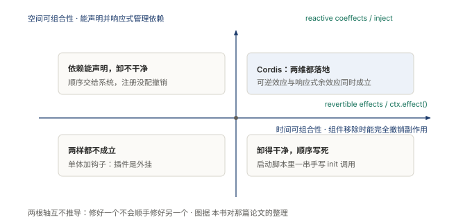
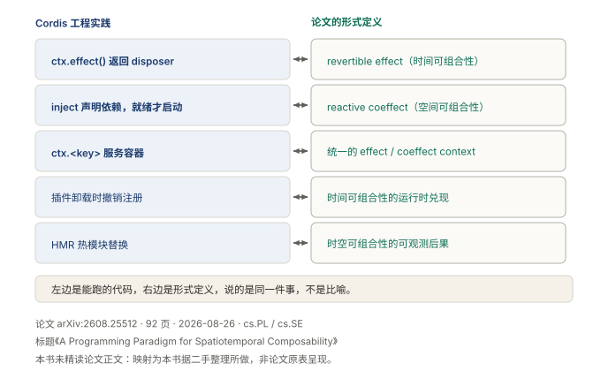
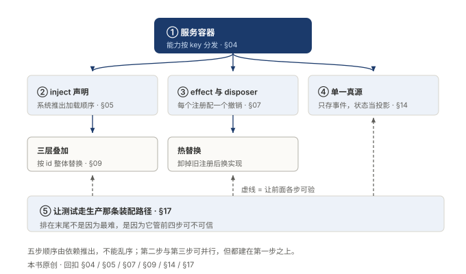

# §17 它在赌什么，代价是什么

全书到这里收梢。剩两件事。一是这套做法不是孤例，它和一套已有的理论讲的是同一件事。二是把它押的赌注和代价摆到明处。

## 17.1 小白版：隔壁行当的一本老账簿

这套组队的法子，不是这家公司发明的。隔壁行当有一本老账簿，记了很多年，翻开来，说的是同一回事。账簿从两个方向打量一支队伍。

横着看：谁需要谁。报名的时候只写名字不写人。喊的是「我要一个会拧螺丝的」，不是「我要小张」。人换了，名字还在，活照干。

竖着看：能不能请走，能不能接着干。请来的人，哪天请走，钥匙门禁全交回，工位恢复原样。活干到一半停下来，本子上记着呢，回来接着干，不用从头来。

这家队伍照着账簿押了两个宝。

一个押在师傅的脑子上：脑子会一茬一茬换，而且越换越快。所以脑子不能焊死在队伍里，得做成能换的。哪天脑子不换了，这个宝就押空了。

另一个押在搭伙的人身上：他们愿意多管一本排班表，愿意让中间隔着一层。哪天没人愿意了，这套组队法就没了主顾。

代价也摆在明处。新来的看这支队，看不懂它在干嘛，得先读懂排班表，把行为从排班表里重建出来。会这么组队的还不多，想找现成的搭伙人，选择很薄。

**图 39：两根轴互相垂直，谁也推不出谁**〔本书〕

横轴管谁需要谁，竖轴管请走与接着干。一支队伍可以请得干干净净，却把顺序写死在墙上；也可以顺序全自动，请走的人留下一串烂摊子。两根轴各管一摊，修好一根，不顺手修好另一根。

## 17.2 专业版：时空可组合与两个赌注

那套理论的正式名字叫时空可组合。一篇公开论文把它当成一个范式来讲，把这套工程当成范式的一个实现。

空间可组合性管谁需要谁：组件间的依赖能被声明，并被响应式地管理。机制名叫响应式余效应，落到工程上，就是按名字查的容器：消费方只写名字，装配方兑现。

时间可组合性管装与卸：组件被移除时，能完全撤销它带来的副作用。机制名叫可逆效应，每个上下文变换带一个逆操作。落到工程上，就是每个注册配一个撤销，以及会话能打断、能从中断处恢复。

两根轴垂直：一个系统可以卸得干干净净，却把顺序写死在脚本里；反过来也成立。时间和空间在这里是比喻，不是性能话题。

**图 40：左列是能跑的工程，右列是形式定义，说的是同一件事**〔本书〕

五行对照，每行一条双向箭头。按名查找、声明依赖、注册配撤销、单一真源、测试对齐生产路径，前面各节讲的每一条机制，都能在右列找到对应的一格。这就是同一件事的意思：不是比喻，是两种写法。

赌注一，模型会长期快速换代。这是模型插件化、外壳独立的全部理由。必答题各家都做：循环、上下文、工具接入、会话持久、权限沙箱。选答题只有它这么选：内核空置、模型插件化、日志可重放。换代一停，间接层的价值就跟着缩水。

赌注二，集成方愿意接受间接层的复杂度。选答题不是更好的答案，是把复杂度从实现方转移给了使用者。成品路线的系统替用户做决定，插座路线的系统给位子。位子上插什么，得自己懂行。

代价跟着赌注来。读懂成本高：装配清单自己不干活，读一遍清单看不出系统在干什么，行为得从配置里重建。生态还薄：插座卖的是位子，位子上现成的插头还不多。

**图 41：迁移的顺序不是自己排的，是从依赖里推出来的**〔本书〕

每个方框是一个动作，箭头是谁得先做。起点是服务容器，它带出两条可并行的分支：声明顺序、注册配撤销。再往下是真源收成一份，末了是测试对齐生产路径。测试排在末尾不是最难，是它给前面所有步骤兜底。

## 17.3 两种说法的对照

| 小白说法 | 专业术语 |
|---|---|
| 老账簿 | 时空可组合理论 |
| 横着看，谁需要谁 | 空间可组合性（依赖声明与响应式管理） |
| 竖着看，请走与接着干 | 时间可组合性（可逆效应、可恢复） |
| 押宝 | 设计赌注 |
| 插座 | 可替换的集成点 |

## 17.4 最容易理解错的地方

第一处：把理论当成工程的背书。两者说的是同一件事，谁也不证明谁。工程能跑，理论能推，各站各的。

第二处：以为修好一根轴就够了。两根轴垂直，互不推导。只修一根，得到的恰好是一半。

第三处：以为选答题是更优解。它不是更好，是把复杂度换了个地方放。愿意接盘的觉得是灵活，不愿意的觉得是麻烦。

第四处：以为赌注稳赢。模型停止换代，或集成方不接受间接层，这套切法的理由就塌了。赌注之所以是赌注，因为它可能输。

## 17.5 这条能搬去哪

这套切法不挑语言，也不挑规模。两个动作就能起步。第一，列出系统里这几年真换过的东西，看换掉它们各要动几处；动得多的，就是下一个该做成能换的。第二，列出从来没换过的，问它们凭什么留在中心；答不上来的，请出去。

为什么这么设计？因为会换的东西焊死了，每一次换代都是一次伤筋动骨。能搬去哪？这套切法能搬去任何一个要长期演化的系统：先问什么会换，把它做成能换的；再问什么不换，留下当底子。

<!-- FIGURES
图 39 fig-19-1-two-axes 〔本书〕
图 40 fig-19-3-mapping 〔本书〕
图 41 fig-20-1-migration-order 〔本书〕
-->
