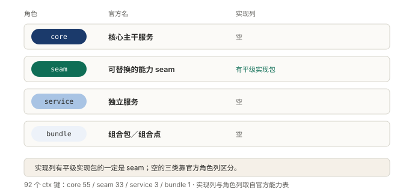
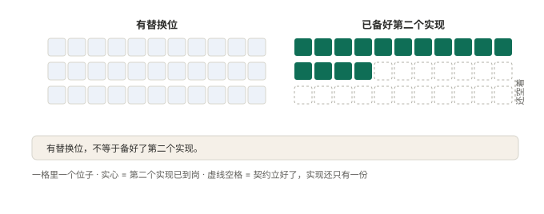

# 附录 C 概念与代码位置对照

正文一律用角色名：模型适配器、工具注册表、会话日志。落到设计时，名字够用；想对着源码看时，名字就不够用了。

这一节补上那一层。前面是概念，后面是它在代码里叫什么、系统里挂的名字是什么。说白了，这是正文的下水道，删掉的代码细节都收在这里。

包名、文件路径、键名只在这里出现，别处一律换成角色名。表里的路径都写成仓库里的相对路径，从仓库根开始。

## 一、概念、代码与键

主表按四类排：内核四件套、能力类主要分组、装配类、边界类。

### 内核四件套

内核是删掉就没法干活的那几件。判断时数依赖，不数代码。

| 概念（角色名） | 代码里叫什么 | 系统里挂的名字 |
|---|---|---|
| 会话日志 | 包 `core/session` | `ctx.sessions` |
| 模型适配器 | 包 `llm/llm` | `ctx.llm` |
| Agent 接口与活跃注册表 | 包 `core/agent` | `ctx.agents` |
| 工具注册表与执行流水线 | 包 `core/tools` | `ctx.tools` |
| 提示词组装 | 包 `core/system-prompt` | `ctx.systemPrompt` |
| 循环驱动器 | 包 `core/agent-loop` | `ctx.agentLoop` |
| 作用域原语 | 包 `core/scope` | 库，无 ctx 键 |

循环驱动器那一行值得多看一眼。它的键是 `ctx.agentLoop`，角色却标成组合包。这就是「循环也只是名单上一行」的落点。

### 能力类主要分组

能力层像一排插孔，一格一种能力。装哪个包，agent 就多哪只手。

| 概念（角色名） | 代码里叫什么 | 系统里挂的名字 |
|---|---|---|
| 跑命令 | 分组 `shell/`，工具包 `shell/tool-bash`、`shell/tool-pwsh` | `ctx.shell` |
| 读写文件 | 分组 `fs/`，工具包 `fs/tool-fs` | `ctx.fs` |
| 接外部工具 | 分组 `mcp/`，包 `mcp/mcp-client`、`mcp/mcp-resources` | `ctx.mcpResources` |
| 加载技能 | 分组 `skill/`，工具包 `skill/tool-skill` | `ctx.skills` |
| 派小弟 | 分组 `subagent/`，工具包 `subagent/tool-subagent` | `ctx.subagents` |
| 联网搜索与抓取 | 分组 `web/`，工具包 `web/tool-web` | `ctx.web` |
| 压缩上下文 | 分组 `compaction/`，后端 `compaction/compaction-basic` | `ctx.compaction` |
| 后台任务 | 分组 `jobs/`，后端 `jobs/jobs-local` | `ctx.jobs` |
| 终端 | 分组 `terminal/`，工具包 `terminal/tool-terminal` | `ctx.terminals` |

分组名和键名不一定同名。接外部工具挂的是 `ctx.mcpResources`，不是 `ctx.mcp`。

### 装配类

装配层只写名单。它的产物不是服务，是一棵树和一份清单。

| 概念（角色名） | 代码里叫什么 | 系统里挂的名字 |
|---|---|---|
| 组装说明书 | 包 `package.json` 的 `dsh.profile` 字段，列出组合包 | 形态名 `web`／`headless`／`sdk`／`sdk-minimal`／`acp` |
| 零件包 | 分组 `bundle/`，patch 文件由 `dsh.bundle` 字段指向 | 如 `bundle/base` |
| 共享底座 | 包 `bundle/base`，清单在 `packages/bundle/base/cordis.patch.yml` | 94 条 `- id:` 条目 |
| 形态层 | 包 `bundle/web-app`、`bundle/headless`、`bundle/sdk-app`、`bundle/acp-app` | 各形态自己的 profile |
| 不套底座的反例 | 包 `bundle/sdk-minimal` | 独立 profile |
| 启动器与热重载 | 分组 `boot/`，如 `boot/app-boot`、`boot/hmr` | —— |

### 边界类

边界层管哪些事不能做。它的活是刹车，产物是一道道否决口。

| 概念（角色名） | 代码里叫什么 | 系统里挂的名字 |
|---|---|---|
| 收紧（策略把关） | 分组 `guard/`；单调守卫在 `core/tools` 内 | 无独立键，排在 `tools/pre-execute` 之后 |
| 审批 | 包 `interaction/user-approval` | `ctx.approval` |
| 隔离（沙箱） | 分组 `sandbox/`，本机后端 `sandbox/sandbox-local` | `ctx.sandbox` |
| 沙箱策略 | 包 `sandbox/sandbox-policy` | `ctx.sandboxPolicy` |
| 权限预设 | 包 `interaction/permission-presets` | `ctx.permissionPresets` |
| 凭据 | 分组 `credentials/`，本机后端 `credentials/credentials-local` | `ctx.credentials` |
| 钩子桥接 | 分组 `hooks/`，如 `hooks/hooks-claude-code` | 事件 `hook/invoked`、`hook/result` |

### 附：事件名对照

正文讲模式，不讲事件名。想顺着事件找源码时，看这张。

| 概念 | 事件名 | 模式 |
|---|---|---|
| 一轮开始与结束 | `turn/start`、`turn/end` | 持久会话事件 |
| 一步开始与结束 | `step/start`、`step/end` | 持久会话事件 |
| 步骤前的决定 | `agent/pre-step` | waterfall |
| 请求发起前 | `agent/request` | waterfall |
| 模型流式输出 | `llm/stream` | waterfall |
| 工具调用前 | `tools/pre-execute` | waterfall |
| 工具环绕分派 | `tools/execute` | waterfall |
| 工具结果后 | `tools/post-execute` | waterfall |
| 工具权威结果 | `tools/result` | emit |
| 审批询问 | `approval/request` | waterfall |
| 会话事件广播 | `session/event` | emit |

## 二、92 个 ctx 键的角色分布

四种角色由官方标注，自己猜不出来。判断一个服务属于哪一类，看的就是角色这一列。

| 角色 | 官方叫法 | 键数 | 有没有替换位 |
|---|---|---|---|
| core | 核心主干服务 | 55 | 没有，单实现 |
| seam | 可替换的能力 seam | 33 | 有 |
| service | 独立服务 | 3 | 没有 |
| bundle | 组合包 | 1 | 没有 |
| 合计 | —— | 92 | —— |

**图 42：角色看实现列，不看重要性**〔本书〕

图上四行，右列是实现列。核心主干、独立服务、组合包三格是空的。只有 seam 那格不空。

59 个键没有替换位，33 个有。能换的不到四成。

能换的那 33 个，还得再数一遍。

**图 12：有替换位，不等于备好了第二个实现**〔重印自 §06〕

横轴 33 格，每格一个 seam。绿色的 15 格已有两个以上平级实现，灰色的 18 格没有。

这 18 格还要再分。15 个只有一份实现，另外 3 个连一份都挂在拥有者身上。那 3 个是 `ctx.authorization`、`ctx.userQuestions`、`ctx.approval`。

留了替换位和备好第二个实现，是两笔账。前者在立契约时就付掉，后者可以晚付。

两笔账，分开算。

## 三、想核这些数字时，去哪儿看

口径集中在这里。想自己复现，按下面几条走。

- 版本：所有统计以 `dsh-0.2.0-rc.2`（2026-09-29，`master`）为准。上游在预览期，换了版本数字会动。
- 包数：读工作区声明 `pnpm-workspace.yaml` 里的 `packages/*/*` 一行，逐个遍历 `packages/<分组>/<包>/package.json`，按包名去重。
- 代码行：数 `.ts` / `.tsx` / `.js` / `.jsx` / `.py`，含测试文件，排除 `node_modules/` 与 `dist/`。
- 依赖边：读每个 `package.json` 的 `dependencies` / `peerDependencies` / `devDependencies`，只看 `@deepseek-ai/dsh-` 前缀的包间引用。
- ctx 键与角色：读仓库里那份能力表，文件名 `capability-seams.zh.md`。按行数 `ctx.<key>` 与角色列；实现列里平级实现包有两个以上的，算备好了第二个实现。
- 装配清单条数：数 `packages/bundle/base/cordis.patch.yml` 里以 `- id:` 开头的行。
- 那 94 行代码：`packages/bundle/base/src/index.ts` 9 行，加 `packages/bundle/base/tests/base.spec.ts` 85 行。

换一种数法，同一个对象会得到另一个数。上面每条都写死了包含与排除，照着重跑能对上。

<!-- FIGURES
图 42 fig-15-1-four-roles 〔本书〕
图 12 fig-15-3-seam-second-impl 〔重印自 §06〕
-->
